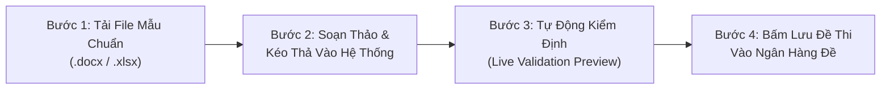
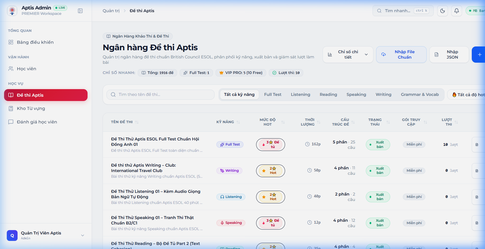
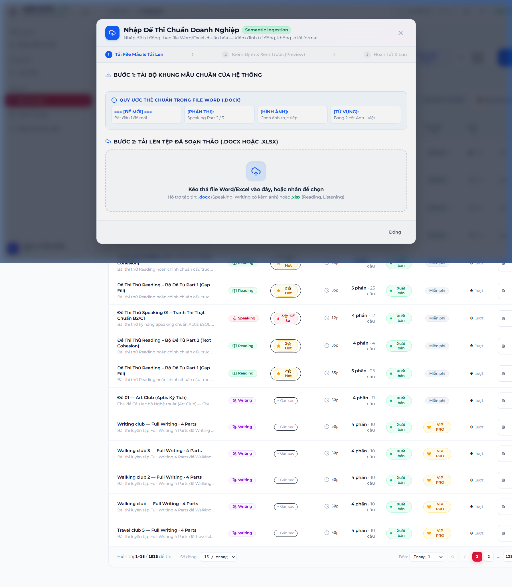

# BỘ HƯỚNG DẪN SỬ DỤNG HỆ THỐNG NHẬP ĐỀ THI CHUẨN DOANH NGHIỆP
> **Hệ thống E-Learning Luyện thi Aptis ESOL & General**  
> **Tính năng:** Smart Semantic Exam Ingestion (Chuẩn British Council)  
> **Áp dụng cho:** Quản trị viên (Admin), Giáo viên & Ban biên soạn đề thi  

---

## 🌟 I. TỔNG QUAN QUY TRÌNH CUỐN CHIẾU 3 BƯỚC

Hệ thống nhập đề thi thông minh được thiết kế theo nguyên tắc **"Không phỏng đoán – Kiểm định cấu trúc trước khi lưu – Tương thích tuyệt đối"**:



---

## 🖥️ II. GIAO DIỆN QUẢN TRỊ & VỊ TRÍ NÚT "NHẬP FILE CHUẨN"

Admin đăng nhập vào hệ thống với tài khoản quản trị viên và truy cập trang **Quản trị Đề thi** (`/admin/exams`).

Trên thanh công cụ chính (phía trên bên phải), nút **"Nhập File Chuẩn"** với biểu tượng đám mây xanh được bố trí cạnh các tính năng nâng cao:



---

## 📥 III. BƯỚC 1: TẢI BỘ KHUNG MẪU CHUẨN (DOWNLOAD TEMPLATES)

Khi bấm vào nút **"Nhập File Chuẩn"**, cửa sổ **Exam Smart Import Modal** mở ra với quy trình hướng dẫn từng bước:



### 1. Tải về 2 bộ khung mẫu chính thức:
* **Bộ Khung Mẫu Speaking & Writing (`.docx`):** [Tải file mẫu Word](templates/Mau_Nhap_De_Speaking_Part2_Part3.docx)
  * Dành cho các bài thi miêu tả tranh Part 2 và cặp tranh so sánh đối chiếu Part 3 có kèm bảng từ vựng song ngữ.
* **Bộ Khung Mẫu Reading & Listening (`.xlsx`):** [Tải file mẫu Excel](templates/Mau_Nhap_De_Reading_Listening.xlsx)
  * Dành cho các bài đọc hiểu và trắc nghiệm câu hỏi nghe kèm các lựa chọn (Options A, B, C, D), đáp án chuẩn và lời giải thích.

---

## ✍️ IV. BƯỚC 2: SOẠN THẢO NỘI DUNG THEO QUY ƯỚC THẺ (SEMANTIC TAGS)

### 1. Quy ước đối với bài thi Speaking Part 2 & Part 3 (File Word `.docx`)
Người soạn bài chỉ cần mở file mẫu Word và điền theo các thẻ quy ước cố định sau:

```text
=== [ĐỀ MỚI] ===
[PHẦN THI]: Speaking Part 2
[CHỦ ĐỀ]: Nhóm người trong phòng họp công ty
[HÌNH ẢNH]:
(Chèn 1 bức ảnh chụp bức tranh thi thật vào Word tại đây)

[TỪ VỰNG]:
(Chèn bảng 2 cột gồm English và Tiếng Việt)
| English         | Tiếng Việt         |
| office          | văn phòng          |
| colleagues      | đồng nghiệp        |
| meeting room    | phòng họp          |
| discussing      | thảo luận          |

[CÂU HỎI 1]: Describe what you see in the picture.
[CÂU HỎI 2]: Tell me about a time when you had to work in a team.
[CÂU HỎI 3]: Why is team cooperation important in the modern workplace?
```

> [!IMPORTANT]
> * **Speaking Part 2:** Yêu cầu chèn **1 bức ảnh** vào mục `[HÌNH ẢNH]`.
> * **Speaking Part 3:** Điền `[PHẦN THI]: Speaking Part 3` và chèn đủ **2 bức ảnh đối chiếu** (Tranh A và Tranh B).
> * **Mỗi đề thi:** Luôn bắt đầu bằng dòng `=== [ĐỀ MỚI] ===` và phải có đủ **3 câu hỏi** theo đúng chuẩn khảo thí Aptis.

---

### 2. Quy ước đối với bài thi Reading & Listening (File Excel `.xlsx`)
Điền các câu hỏi theo từng dòng trong bảng tính Excel:

| Cột | Ý nghĩa | Ví dụ |
| :--- | :--- | :--- |
| **Skill** | Kỹ năng (`READING` hoặc `LISTENING`) | `READING` |
| **Part** | Phần thi (1, 2, 3 hoặc 4) | `1` |
| **Topic** | Tên chủ đề thực tế | `Thư mời sinh nhật` |
| **Passage_Text** | Bài đọc hoặc Transcript bài nghe | `Dear Sarah, I am writing to invite...` |
| **Question_No** | Thứ tự câu hỏi | `1` |
| **Prompt** | Nội dung câu hỏi / Câu văn đục lỗ | `The party will be held at _______ house.` |
| **Option_A / B / C / D** | 4 phương án lựa chọn | `my` / `mine` / `me` / `I` |
| **Correct_Answer** | Đáp án chính xác | `my` |
| **Explanation** | Giải thích ngữ pháp / từ vựng | `Tính từ sở hữu đứng trước danh từ house` |

---

## 🔍 V. BƯỚC 3: KÉO THẢ TỆP & KIỂM ĐỊNH TỰ ĐỘNG (PRE-VALIDATION)

1. Kéo thả file Word (`.docx`) hoặc Excel (`.xlsx`) đã soạn vào vùng tải lên (Dropzone).
2. Hệ thống chạy thuật toán phân tích và bóc tách tự động:
   * **Bóc tách Media:** Quét toàn bộ hình ảnh nhị phân trong `word/media/`, chuyển đổi và lưu trữ an toàn trên máy chủ.
   * **Xác thực cấu trúc (Schema Check):**
     * 🟢 **Đạt chuẩn (Valid):** Đề có đủ chủ đề, đủ ảnh, đủ 3 câu hỏi.
     * 🔴 **Báo lỗi định dạng (Invalid):** Nếu thiếu ảnh hoặc chỉ có 2 câu hỏi, hệ thống sẽ gán nhãn cảnh báo chính xác tại đề đó để người dùng nhận biết ngay lập tức.

---

## 🚀 VI. BƯỚC 4: LIVE PREVIEW & XÁC NHẬN LƯU VÀO CƠ SỞ DỮ LIỆU

1. **Xem trước (Live Preview):**
   * Người dùng có thể kiểm tra danh sách tất cả các đề bóc tách được:
     * Thumbnail hình ảnh trực quan.
     * Tên chủ đề và nhãn Part.
     * Danh sách 3 câu hỏi hiển thị chi tiết.
     * Các tag từ vựng song ngữ Anh - Việt.
2. **Lưu dữ liệu:**
   * Bấm nút **"Lưu X Đề Hợp Lệ Vào Hệ Thống"**.
   * Hệ thống tự động tạo các bản ghi `Exam`, `ExamPart`, `Question` tương ứng trong cơ sở dữ liệu PostgreSQL.
   * Danh sách đề thi được làm mới ngay lập tức trên hệ thống thi thử của học viên.

---

## 📞 HỖ TRỢ VÀ GIẢI ĐÁP KỸ THUẬT
* **Đơn vị phát triển:** Aptis Premier Engineering Team
* **Tài khoản quản trị thử nghiệm:** `admin@aptiskytich.vn` | `Admin123!@#`
* **Đường dẫn tải tài liệu:** [Huong_Dan_Nhap_De_Thi_Chuan_Doanh_Nghiep.md](docs/Huong_Dan_Nhap_De_Thi_Chuan_Doanh_Nghiep.md)
