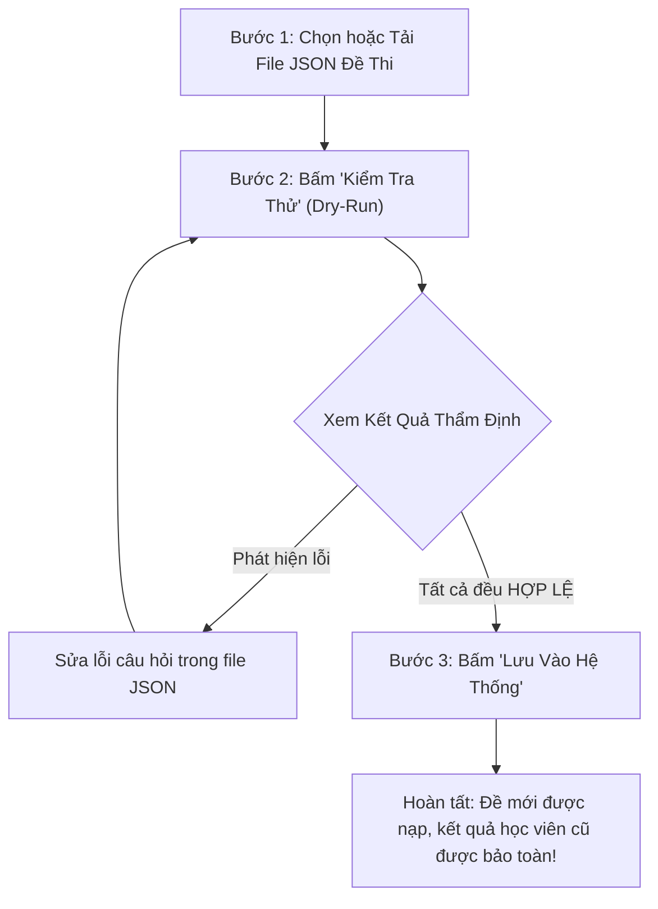
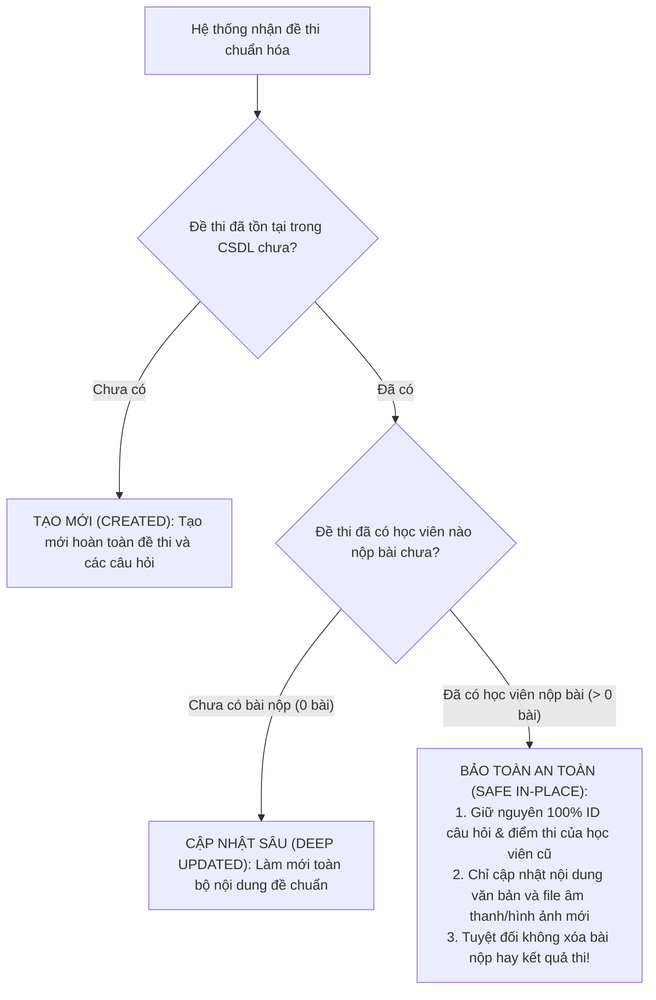

# HƯỚNG DẪN CHI TIẾT SỬ DỤNG TRUNG TÂM QUẢN LÝ & TỐI ƯU DỮ LIỆU ĐỀ THI
> **Hệ thống Luyện thi & Thi thử Aptis ESOL Premier**  
> **Đường dẫn truy cập**: [https://aptisesolpremier.com/admin/data-sync](https://aptisesolpremier.com/admin/data-sync)  
> **Đối tượng sử dụng**: Ban Quản Trị Hệ Thống, Quản Trị Viên Học Vụ, Giáo Viên Quản Lý Nội Dung Đề Thi.

---

## MỤC LỤC
1. [Giới Thiệu Tổng Quan & Mục Đích](#1-giới-thiệu-tổng-quan--mục-đích)
2. [Giải Thích Các Chỉ Số & Thẻ Cảnh Báo](#2-giải-thích-các-chỉ-số--thẻ-cảnh-báo)
3. [Hướng Dẫn Sử Dụng 3 Chức Năng Chính](#3-hướng-dẫn-sử-dụng-3-chức-năng-chính)
   - [Chức năng 1: Sức Khỏe Kho Đề & Tự Động Sửa Lỗi (1 Bấm)](#chức-năng-1-sức-khỏe-kho-đề--tự-động-sửa-lỗi-1-bấm)
   - [Chức năng 2: Kiểm Tra Phòng Thi Thực Tế (5 Kỹ Năng)](#chức-năng-2-kiểm-tra-phòng-thi-thực-tế-5-kỹ-năng)
   - [Chức năng 3: Thêm & Cập Nhật Đề Thi Hàng Loạt](#chức-năng-3-thêm--cập-nhật-đề-thi-hàng-loạt)
4. [Cơ Chế Bảo Toàn Kết Quả Thi Của Học Viên (An Toàn 100%)](#4-cơ-chế-bảo-toàn-kết-quả-thi-của-học-viên-an-toàn-100)
5. [Quy Trình Vận Hành Chuẩn Định Kỳ](#5-quy-trình-vận-hành-chuẩn-định-kỳ)
6. [Giải Đáp Thắc Mắc Thường Gặp (FAQ)](#6-giải-đáp-thắc-mắc-thường-gặp-faq)

---

## 1. Giới Thiệu Tổng Quan & Mục Đích

### 1.1. Bối cảnh
Hệ thống **Aptis ESOL Premier** hiện đang vận hành một kho đề thi khổng lồ với hơn **1,690+ đề thi** và hơn **15,300+ câu hỏi**, phục vụ hàng nghìn học viên luyện thi mỗi ngày cho đủ 5 kỹ năng:
- **Reading (Đọc)**: 4 Phần thi (Điền từ đoạn văn, Kéo thả sắp xếp câu, Nối quan điểm 4 người, Nối tiêu đề đoạn văn).
- **Listening (Nghe)**: 4 Phần thi (Nghe hội thoại ngắn A/B/C/D, Nối người nói, Đối thoại chuyên sâu, Độc thoại học thuật).
- **Writing (Viết)**: 4 Phần thi (Trả lời tin nhắn 1-5 từ, Điền biểu mẫu 20-30 từ, Tham gia phòng chat 30-40 từ, Viết 2 email thân mật & trang trọng).
- **Speaking (Nói)**: 4 Phần thi (Ghi âm câu hỏi cá nhân 30s, Miêu tả 1 tranh 45s, So sánh 2 tranh 45s, Thuyết trình chủ đề 2 phút).
- **Grammar & Vocabulary**: 50 câu trắc nghiệm ngữ pháp và từ vựng.
- **Full Test**: Đề thi thử liên hoàn 16 Parts mô phỏng 100% kỳ thi thật của Hội Đồng Anh (British Council).

### 1.2. Mục đích ra đời của trang
Trong quá trình giáo viên biên soạn đề hoặc nhập đề từ các nguồn dữ liệu bên ngoài, rất dễ xảy ra các sai sót kỹ thuật như:
- Đề thi được tạo nhưng để trống không có câu hỏi nào (Đề rỗng).
- Nhiều đề thi bị đặt tên giống hệt nhau gây trùng lặp, học viên vào làm đi làm lại một đề.
- Câu hỏi Speaking nhưng bị lưu nhầm thành câu trắc nghiệm (dẫn đến phòng thi không hiện microphone để thu âm).
- Câu trắc nghiệm bị thiếu các phương án chọn A/B/C/D (khiến học viên không thể chọn đáp án để nộp bài).

**Trang "Quản Lý & Tối Ưu Dữ Liệu Ngân Hàng Đề Thi"** ra đời như một **"Trạm Kiểm Định Chất Lượng Trung Tâm"**, giúp Quản trị viên và Đội ngũ Học vụ:
1. Nắm bắt tức thì sức khỏe toàn bộ kho đề thông qua các chỉ số trực quan.
2. Tự động khắc phục toàn bộ lỗi định dạng chỉ với **1 bấm** mà không cần can thiệp kỹ thuật vào mã nguồn.
3. Giả lập học viên vào thi thử để kiểm tra hiển thị trước khi mở cho học viên thật làm bài.
4. Nạp thêm hàng trăm đề thi mới an toàn, không bao giờ lo bị mất điểm hay lịch sử làm bài của học viên.

---

## 2. Giải Thích Các Chỉ Số & Thẻ Cảnh Báo

### 2.1. Bốn thẻ chỉ số thống kê (KPI Cards)
Ngay trên đầu trang là 4 thẻ thông tin quan trọng phản ánh toàn cảnh kho đề:

| Thẻ chỉ số | Ý nghĩa thực tế | Trạng thái lý tưởng |
| :--- | :--- | :--- |
| **Tổng Số Đề Thi** | Tổng số bài thi đang có trên website mà học viên có thể bấm vào luyện tập. Con số này đã gom nhóm và loại trừ các đề nhân bản rác. | Tăng dần khi nạp thêm đề mới |
| **Tổng Phần Thi (Parts)** | Tổng số phân vùng bài làm (Part 1 đến Part 4 của các kỹ năng đơn lẻ, và 16 Parts của đề Full Test liên hoàn). | Khớp với cơ cấu đề thi |
| **Tổng Số Câu Hỏi** | Toàn bộ các câu hỏi trắc nghiệm, điền từ, thu âm, viết luận... có trong hệ thống. | > 15,000 câu |
| **Độ Hoàn Hảo Dữ Liệu (%)** | Điểm đánh giá chất lượng chuẩn mực của kho đề. Hệ thống tính toán dựa trên số lượng lỗi phát hiện trên tổng số đề. | **100% (HOÀN HẢO)** |

### 2.2. Bốn thẻ cảnh báo bất thường
Bên dưới tiêu đề Tab 1 là 4 hộp kiểm định cảnh báo:

1. **Đề / Phần Thi Trống**:
   - *Hiện tượng*: Đề thi hoặc phần thi đã được tạo trong danh sách nhưng bên trong có `0` câu hỏi.
   - *Nguy cơ*: Nếu học viên bấm vào làm đề này, màn hình sẽ trắng trơn hoặc báo không tìm thấy câu hỏi.
   - *Hành động*: Bấm nút *"Bắt Đầu Tự Động Sửa Lỗi & Gộp Đề"* để hệ thống tự động dọn dẹp các đề rỗng này.

2. **Đề Thi Trùng Tên Cần Gộp**:
   - *Hiện tượng*: Trong cùng một kỹ năng xuất hiện từ 2 đề thi trở lên có tên gọi giống hệt nhau (ví dụ có 2 đề đều tên *"Reading Test 01"*).
   - *Nguy cơ*: Học viên bị rối mắt, làm trùng lặp đề hoặc lịch sử làm bài bị phân tán.
   - *Hành động*: Bấm nút *"Bắt Đầu Tự Động Sửa Lỗi & Gộp Đề"*. Hệ thống sẽ tự động gộp lại thành 1 đề duy nhất, ưu tiên giữ lại đề có nhiều học viên nộp bài nhất và nhiều câu hỏi nhất.

3. **Câu Hỏi Chưa Đúng Dạng Bài**:
   - *Hiện tượng*: Một câu hỏi thuộc phần thi Nói (Speaking) nhưng kiểu câu hỏi lại lưu là Trắc nghiệm; hoặc Reading Part 1 (Điền từ) lại lưu là Trắc nghiệm đơn lẻ.
   - *Nguy cơ*: Phòng thi học viên hiển thị sai giao diện tương tác (không bật được micro thu âm, không có ô kéo thả từ vựng).
   - *Hành động*: Nút tự động sửa sẽ quét và chuyển đổi câu hỏi về đúng loại chuẩn khảo thí British Council.

4. **Câu Trắc Nghiệm Thiếu Lựa Chọn**:
   - *Hiện tượng*: Câu hỏi trắc nghiệm hoặc điền từ có ít hơn 2 phương án chọn (chỉ có 1 hoặc 0 phương án).
   - *Nguy cơ*: Học viên không có đáp án để bấm chọn và không thể hoàn thành bài thi.
   - *Hành động*: Quản trị viên sang Tab 2 xem danh sách đề bị lỗi, nhấp vào tên đề để bổ sung các phương án A/B/C/D.

---

## 3. Hướng Dẫn Sử Dụng 3 Chức Năng Chính

---

### Chức năng 1: Sức Khỏe Kho Đề & Tự Động Sửa Lỗi (1 Bấm)
*(Tab 1: Wrench Icon)*

#### Khi nào nên sử dụng?
- Thẻ **"Độ Hoàn Hảo Dữ Liệu"** hiển thị dưới 100% hoặc có nhãn màu vàng **"CẦN TỐI ƯU"**.
- Có bất kỳ thẻ cảnh báo nào mang nhãn **CẦN DỌN**, **CẦN GỘP** hoặc **CẦN SỬA**.
- Sau khi Ban học vụ vừa nạp thêm một tệp đề thi mới.

#### Thao tác thực hiện:
1. Nhấp vào Tab **"1. Sức Khỏe Kho Đề & Tự Động Sửa Lỗi (1 Chạm)"**.
2. Nhấp vào nút màu cam **"Bắt Đầu Tự Động Sửa Lỗi & Gộp Đề"** ở góc phải trên.
3. Chờ 1–3 giây. Hệ thống sẽ hiển thị bảng thông báo màu xanh báo cáo chi tiết:
   - Số tên đề đã được chuẩn hóa (ví dụ "Đề 1" thành "Đề 01").
   - Số đề trùng lặp đã được gộp.
   - Số đề rỗng đã được dọn sạch.
   - Số câu hỏi đã được sửa về đúng dạng bài chuẩn.
4. Thẻ **Độ Hoàn Hảo Dữ Liệu** sẽ tự động nhảy lên **100% HOÀN HẢO**.

---

### Chức năng 2: Kiểm Tra Phòng Thi Thực Tế (5 Kỹ Năng)
*(Tab 2: Activity Icon)*

#### Ý nghĩa tính năng:
Đây là bộ kiểm thử tự động đóng vai trò như một **"Học viên VIP ảo"**. Hệ thống sẽ gửi yêu cầu lấy đề trực tiếp qua cổng giao diện của học viên để kiểm tra thực tế xem:
- Đề thi có load ra đủ Part 1, Part 2, Part 3, Part 4 không?
- Part 1 Reading có đúng là điền từ không? Part 2 có đúng là kéo thả sắp xếp câu không?
- Speaking có đúng là câu hỏi thu âm microphone không?
- Listening có file nghe audio không?

#### Thao tác thực hiện:
1. Chọn Tab **"2. Kiểm Tra Phòng Thi Thực Tế (5 Kỹ Năng)"**.
2. Tại ô **"Số đề mẫu/kỹ năng"**, bạn có thể chọn số lượng đề muốn lấy ra kiểm tra (ví dụ 20 đề, 35 đề hoặc 60 đề mỗi kỹ năng).
3. Nhấp vào nút **"Bắt Đầu Kiểm Tra Phòng Thi"**.
4. Sau khi kiểm tra xong:
   - Các dòng hiển thị nhãn **ĐẠT CHUẨN (PASS)** màu xanh chứng tỏ học viên mở đề này sẽ làm bài trơn tru 100%.
   - Nếu có dòng hiển thị nhãn **CẦN SỬA (FAIL)** màu đỏ: Hệ thống sẽ hiển thị tên đề thi kèm theo lý do cụ thể. Bạn có thể **nhấp chuột trực tiếp vào tên đề thi** (ở cột *Đề mẫu xem thử*) để hệ thống mở ngay trang chỉnh sửa đề thi đó!
5. **Xuất báo cáo**: Nhấp vào nút **"Tải Báo Cáo (.md)"** để tải về một tệp tài liệu tổng hợp toàn bộ kết quả kiểm tra để lưu trữ hoặc gửi báo cáo cho cấp quản lý.

---

### Chức năng 3: Thêm & Cập Nhật Đề Thi Hàng Loạt
*(Tab 3: Upload Icon)*

Trang cung cấp 2 phương thức nạp đề:
- **Cách 1: Nạp từ kho đề có sẵn trên hệ thống**: Dành cho các gói dữ liệu Snapshot đã được thu thập và đóng gói sẵn trên máy chủ (ví dụ: kho đề Aptis Academy, Aptis Kỳ Tích).
- **Cách 2: Tải tệp dữ liệu đề thi (.json) từ máy tính**: Dành cho Quản trị viên muốn nạp thêm đề thi mới tự biên soạn từ máy tính cá nhân.

#### QUY TRÌNH 3 BƯỚC NẠP ĐỀ AN TOÀN CHUẨN:

1. **Bước 1**: Tải lên tệp JSON hoặc chọn kho đề trên server. Chọn đúng nhãn nguồn (Source Tag) tương ứng (ví dụ: *APTIS_ACADEMY*, *KEY - Bộ đề tủ*, hoặc *WEB*).
2. **Bước 2: LUÔN BẤM "KIỂM TRA THỬ (CHƯA LƯU)" TRƯỚC**:
   - Chức năng này sẽ giải mã và kiểm tra toàn bộ câu hỏi trong file mà **hoàn toàn KHÔNG ghi đè CSDL**.
   - Bảng kết quả sẽ chỉ rõ: Bao nhiêu đề hợp lệ, bao nhiêu đề bị lỗi và lỗi cụ thể ở câu nào.
3. **Bước 3: BẤM "LƯU VÀO HỆ THỐNG"**:
   - Sau khi kiểm tra thử thấy danh sách đề đều hợp lệ, bấm nút này để hệ thống chính thức lưu vào CSDL.
   - Tiến trình sẽ tự động phân loại: đề mới thì tạo mới, đề cũ thì cập nhật nội dung văn bản và bảo toàn nguyên vẹn bài thi của học viên.

---

## 4. Cơ Chế Bảo Toàn Kết Quả Thi Của Học Viên (An Toàn 100%)

Một trong những nỗi lo lớn nhất của Quản trị viên khi nạp đề thi là: **"Liệu có làm mất điểm số, lịch sử làm bài hay bài thi của học viên cũ đã làm đề này không?"**

Hệ thống được trang bị công nghệ **Cập Nhật Thông Minh (Deep Idempotent Upsert Engine)** với 2 tầng bảo vệ tuyệt đối:

> [!IMPORTANT]
> **Cam kết an toàn dữ liệu:**
> - Điểm số, ngày nộp bài, thời gian làm bài, nhận xét chấm điểm AI của học viên đối với đề thi cũ **được giữ nguyên vẹn 100%**.
> - Không bao giờ xảy ra tình trạng học viên bị mất lịch sử thi sau khi Quản trị viên nạp đề mới!

---

## 5. Quy Trình Vận Hành Chuẩn Định Kỳ

Để đảm bảo website học tập luôn ở trạng thái tốt nhất cho học viên, Ban Quản Trị và Bộ Phận Học Vụ nên áp dụng lịch kiểm tra sau:

### Lịch kiểm tra hàng tuần (Mỗi Thứ Hai hoặc Thứ Sáu):
1. Truy cập [https://aptisesolpremier.com/admin/data-sync](https://aptisesolpremier.com/admin/data-sync).
2. Nhìn thẻ **"Độ Hoàn Hảo Dữ Liệu"**:
   - Nếu hiển thị **100% (HOÀN HẢO)**: Hệ thống đang vận hành hoàn hảo, không cần làm gì thêm.
   - Nếu hiển thị dưới 100%: Bấm ngay nút **"Bắt Đầu Tự Động Sửa Lỗi & Gộp Đề"** để đưa kho đề về 100%.
3. Chuyển sang Tab 2, chọn 35 đề mẫu và bấm **"Bắt Đầu Kiểm Tra Phòng Thi"** để rà soát chất lượng hiển thị thực tế của học viên.

### Quy trình khi vừa nhận gói đề thi mới từ Giáo viên:
1. Chuẩn bị file `.json` đề thi trên máy tính.
2. Vào Tab 3, tải file lên và bấm **"Kiểm Tra Thử (Chưa Lưu)"**.
3. Xem bảng kết quả: nếu tất cả đề đều báo **HỢP LỆ**, bấm **"Lưu Vào Hệ Thống"**.
4. Chuyển sang Tab 1, bấm **"Bắt Đầu Tự Động Sửa Lỗi & Gộp Đề"** để tự động chuẩn hóa tên gọi của các đề vừa nạp.
5. Hoàn tất! Đề thi mới đã sẵn sàng cho học viên vào luyện tập.

---

## 6. Giải Đáp Thắc Mắc Thường Gặp (FAQ)

### Câu hỏi 1: Nút "📖 Hướng dẫn & Giải thích tính năng" ở đầu trang dùng để làm gì?
**Trả lời:** Đó là cuốn cẩm nang tương tác trực tiếp trên web. Khi bạn hoặc bất kỳ quản trị viên nào quên cách dùng hoặc không hiểu một chỉ số, chỉ cần bấm vào nút đó. Một bảng hướng dẫn trực quan chia theo từng chủ đề sẽ hiện ra ngay trên màn hình để bạn tra cứu nhanh mà không cần mở tài liệu ngoài.

### Câu hỏi 2: Nút "Sao lưu CSDL" ở góc phải dẫn đi đâu?
**Trả lời:** Nút đó dẫn tới trang quản lý Sao lưu CSDL (`/admin/database-backup`). Trước khi nạp một đợt đề thi lớn (vài trăm đề), bạn có thể bấm vào đó để tạo một bản sao lưu dữ liệu dự phòng an toàn chỉ với 1 click.

### Câu hỏi 3: Nếu thấy câu trắc nghiệm bị báo "Cần lưu ý" (thiếu phương án lựa chọn) thì sửa ở đâu?
**Trả lời:** Bạn sang Tab **"2. Kiểm Tra Phòng Thi Thực Tế"**, bấm chạy kiểm tra. Bảng kết quả sẽ hiển thị chính xác tên của đề thi có câu hỏi bị thiếu đáp án. Bạn bấm trực tiếp vào tên đề thi ở cột *Đề mẫu xem thử*, hệ thống sẽ mở ra trang chỉnh sửa để bạn gõ thêm các lựa chọn A, B, C, D cho câu hỏi đó.

### Câu hỏi 4: Tệp JSON đề thi tải lên có bị giới hạn dung lượng không?
**Trả lời:** Hệ thống hỗ trợ tệp JSON dung lượng lên tới **30MB** (tương đương khoảng 300–500 đề thi cùng lúc). Thời gian xử lý kiểm tra thử chỉ mất từ 1–3 giây.

---
*Tài liệu được biên soạn và chuẩn hóa phục vụ công tác quản trị vận hành hệ thống Aptis ESOL Premier.*

