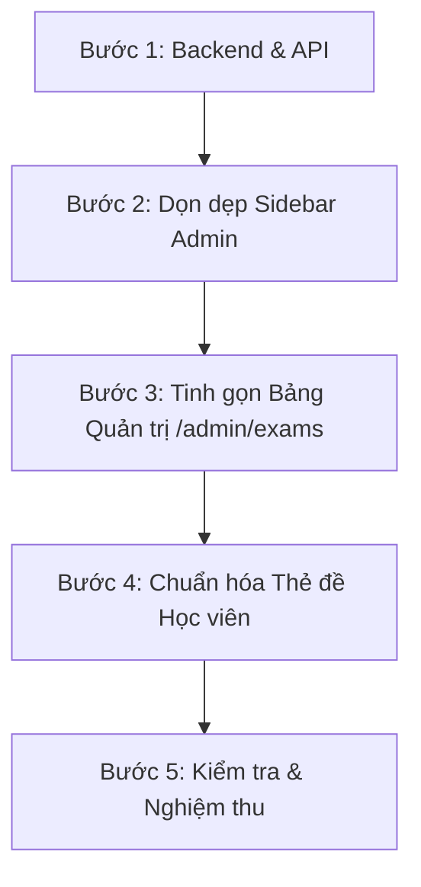

# KẾ HOẠCH TRIỂN KHAI (IMPLEMENTATION PLAN)

## CHUẨN HÓA HỆ THỐNG GÁN NHÃN CỎ ☘️ & TINH GỌN BỘ QUẢN TRỊ ĐỀ THI

> **Trạng thái:** Chờ xác nhận từ Quản trị viên trước khi thực thi mã nguồn.  
> **Phạm vi:** Backend, Database Mapping, Frontend Admin, Frontend Client Học viên.  
> **Thời gian dự kiến triển khai:** ~30 phút.

---

## I. MỤC TIÊU DỰ ÁN

1. **Loại bỏ hoàn toàn biểu tượng Sao ☘️**:
   - Thống nhất 100% toàn hệ thống chỉ sử dụng biểu tượng thương hiệu **Cỏ may mắn ☘️** (thang điểm từ `1` đến `5` cỏ).
2. **Tinh giản giao diện Học viên (Client-side)**:
   - **Chỉ hiển thị số lượng icon Cỏ ☘️**: `☘️☘️☘️☘️☘️` (5 cỏ), `☘️☘️☘️☘️` (4 cỏ), `☘️☘️☘️` (3 cỏ), `☘️☘️` (2 cỏ), `☘️` (1 cỏ).
   - **Bỏ toàn bộ các dòng chữ giải thích rườm rà** (_"Xác suất trúng 90%"_, _"Tần suất cao"_, _"Tham khảo"_...). Học viên nhìn số lượng cỏ là tự hiểu độ ưu tiên ôn tập.
3. **Giữ nguyên khả năng lưu trữ ghi chú nội bộ cho Admin**:
   - Admin vẫn có ô nhập **Ghi chú nội bộ / Nhãn dự đoán (`forecast_tag`)** và **Mô tả (`description`)** để lưu thông tin nghiệp vụ (nguồn đề thi thật, ngày thi, ca thi BC).
   - Thông tin này phục vụ giáo viên/admin đối soát, **không hiển thị đè lên giao diện học viên**.
4. **Dọn dẹp Sidebar Admin & Tinh gọn thao tác**:
   - **Ẩn menu thừa `/admin/key-du-doan`** khỏi Sidebar Admin.
   - Tập trung toàn bộ thao tác gán cỏ vào một nơi duy nhất: **Kho Đề thi Aptis ([`/admin/exams`](file:///c:/Users/hiepth/OneDrive%20-%20MERCANTILE%20EXCHANGE%20OF%20VIETNAM/Documents/Github/aptis-elearning/frontend/src/app/admin/exams/page.tsx))**.
   - Thao tác 1-Click xoay vòng hoặc chọn số cỏ trực tiếp trên từng dòng đề thi: `0 ➔ 1 ➔ 2 ➔ 3 ➔ 4 ➔ 5 ➔ 0`.

---

## II. MA TRẬN ÁNH XẠ DỮ LIỆU (DATA MAPPING)

| Giá trị `hot_level` trong DB |  Biểu tượng Admin   | Hiển thị ngoài Học viên | Ý nghĩa ngầm định (Học viên tự hiểu)     |
| :--------------------------: | :-----------------: | :---------------------: | :--------------------------------------- |
|           **`5`**            | `☘️☘️☘️☘️☘️` (5 Cỏ) |      `☘️☘️☘️☘️☘️`       | Đề tủ trúng cao nhất (>90%)              |
|           **`4`**            |  `☘️☘️☘️☘️` (4 Cỏ)  |       `☘️☘️☘️☘️`        | Tần suất thi thực tế xuất hiện rất nhiều |
|           **`3`**            |   `☘️☘️☘️` (3 Cỏ)   |        `☘️☘️☘️`         | Đề thường gặp trong các đợt thi          |
|           **`2`**            |    `☘️☘️` (2 Cỏ)    |         `☘️☘️`          | Đề luyện tập bổ trợ / tham khảo thêm     |
|           **`1`**            |     `☘️` (1 Cỏ)     |          `☘️`           | Đề cơ bản nền tảng                       |
|           **`0`**            |    `⚪ Chưa gán`    |  _(Không hiện badge)_   | Đề thi bình thường trong kho chung       |

---

## III. CHI TIẾT CÁC BƯỚC THỰC HIỆN

### Bước 1: Cập nhật Backend API (`admin.service.ts`)

- **Tệp tin**: [`backend/src/modules/admin/admin.service.ts`](file:///c:/Users/hiepth/OneDrive%20-%20MERCANTILE%20EXCHANGE%20OF%20VIETNAM/Documents/Github/aptis-elearning/backend/src/modules/admin/admin.service.ts)
- **Nội dung thực hiện**:
  - Mở rộng logic lọc `hotLevel` trong hàm `listExams`:
    - `HOT_5` $\rightarrow$ `where.hot_level = 5`
    - `HOT_4` $\rightarrow$ `where.hot_level = 4`
    - `HOT_3` $\rightarrow$ `where.hot_level = 3`
    - `HOT_2` $\rightarrow$ `where.hot_level = 2`
    - `HOT_1` $\rightarrow$ `where.hot_level = 1`
    - `HOT_0` $\rightarrow$ `where.OR = [{ hot_level: null }, { hot_level: 0 }]`
    - `HOT_ALL` $\rightarrow$ `where.hot_level = { gt: 0 }`
  - Đảm bảo API `updateExam` nhận và lưu chuẩn số nguyên `0 - 5` cho `hotLevel` và chuỗi ghi chú `forecastTag`.

### Bước 2: Dọn dẹp Sidebar Admin (`admin/layout.tsx`)

- **Tệp tin**: [`frontend/src/app/admin/layout.tsx`](file:///c:/Users/hiepth/OneDrive%20-%20MERCANTILE%20EXCHANGE%20OF%20VIETNAM/Documents/Github/aptis-elearning/frontend/src/app/admin/layout.tsx)
- **Nội dung thực hiện**:
  - Ẩn/loại bỏ dòng menu `Đề Key Dự Đoán ☘️` (`/admin/key-du-doan`) khỏi nhóm **HỌC VỤ**.
  - Giữ Sidebar gọn gàng với 3 mục Học vụ cốt lõi:
    1. Đề thi Aptis (`/admin/exams`)
    2. Kho Từ vựng (`/admin/vocabulary`)
    3. Đánh giá học viên (`/admin/reviews`)

### Bước 3: Nâng cấp Bảng Quản trị Đề thi ([`/admin/exams`](file:///c:/Users/hiepth/OneDrive%20-%20MERCANTILE%20EXCHANGE%20OF%20VIETNAM/Documents/Github/aptis-elearning/frontend/src/app/admin/exams/page.tsx))

- **Tệp tin**:
  - [`frontend/src/app/admin/exams/page.tsx`](file:///c:/Users/hiepth/OneDrive%20-%20MERCANTILE%20EXCHANGE%20OF%20VIETNAM/Documents/Github/aptis-elearning/frontend/src/app/admin/exams/page.tsx)
  - [`frontend/src/components/admin/exams/exam-edit-modal.tsx`](file:///c:/Users/hiepth/OneDrive%20-%20MERCANTILE%20EXCHANGE%20OF%20VIETNAM/Documents/Github/aptis-elearning/frontend/src/components/admin/exams/exam-edit-modal.tsx)
  - [`frontend/src/components/admin/exams/exam.types.ts`](file:///c:/Users/hiepth/OneDrive%20-%20MERCANTILE%20EXCHANGE%20OF%20VIETNAM/Documents/Github/aptis-elearning/frontend/src/components/admin/exams/exam.types.ts)
- **Nội dung thực hiện**:
  1. **Cột Độ Hot**:
     - Đổi tên cột thành `Độ Hot ☘️`.
     - Bỏ hoàn toàn icon sao ☘️, render chuỗi icon cỏ xanh: `☘️☘️☘️☘️☘️` (5 cỏ) đến `☘️` (1 cỏ).
     - Bấm click 1 chạm xoay vòng: `0 ➔ 1 ➔ 2 ➔ 3 ➔ 4 ➔ 5 ➔ 0` và lưu ngay lập tức vào DB.
  2. **Thanh lọc tìm kiếm**:
     - Bổ sung nút/dropdown lọc theo độ hot: `[Tất cả]` `[5☘️]` `[4☘️]` `[3☘️]` `[2☘️]` `[1☘️]`.
  3. **Modal cấu hình nhanh (`ExamEditModal`)**:
     - Dropdown chọn Mức độ Hot từ `0` đến `5 Cỏ ☘️`.
     - Bổ sung ô nhập văn bản: **"Ghi chú nội bộ / Nhãn dự đoán" (`forecastTag`)** (Ví dụ: _"Đề thi thật ca sáng 20/10"_).

### Bước 4: Chuẩn hóa hiển thị Thẻ đề Học viên (Client)

- **Tệp tin**:
  - [`frontend/src/lib/clover-utils.ts`](file:///c:/Users/hiepth/OneDrive%20-%20MERCANTILE%20EXCHANGE%20OF%20VIETNAM/Documents/Github/aptis-elearning/frontend/src/lib/clover-utils.ts)
  - Các trang danh sách kỹ năng: Reading, Speaking, Listening, Writing, Thi thử.
- **Nội dung thực hiện**:
  - Tối ưu hàm `formatCloverBadge(level)`:
    - Nếu `level > 0`: Chỉ in ra `☘️`.repeat(level) bên trong một badge nhỏ gọn, màu xanh ngọc thanh lịch.
    - **Xóa bỏ toàn bộ các chuỗi text dài dòng**: Không chèn thêm chữ giải thích.
  - Thẻ đề hiển thị thoáng đãng, học viên nhìn vào số icon cỏ là nhận biết ngay lập tức.

---

## IV. TIÊU CHÍ NGHIỆM THU (ACCEPTANCE CRITERIA)

|  STT  | Tiêu chí nghiệm thu             | Trạng thái mong đợi                                                                                            |
| :---: | :------------------------------ | :------------------------------------------------------------------------------------------------------------- |
| **1** | **Xóa sạch Sao ☘️**             | Không còn bất kỳ icon sao ☘️ nào tại cột độ hot hay bộ lọc của Admin và Client.                                |
| **2** | **Thang điểm 1-5 Cỏ ☘️**        | Admin bấm click gán đề đạt đủ 5 mức cỏ (`1☘️` đến `5☘️`).                                                      |
| **3** | **Sidebar Admin gọn gàng**      | Menu `/admin/key-du-doan` được ẩn hoàn toàn; Sidebar không bị phân mảnh.                                       |
| **4** | **Giao diện Học viên tối giản** | Thẻ đề chỉ hiện số icon cỏ (VD: `☘️☘️☘️☘️☘️`), không kèm chữ dài dòng.                                         |
| **5** | **Ghi chú nội bộ Admin**        | Admin gõ ghi chú nguồn đề (`forecastTag`) lưu thành công trong DB nhưng không bị tràn ra ngoài trang học sinh. |
| **6** | **Kiểm tra biên dịch**          | Chạy `npx tsc --noEmit` trên cả Backend và Frontend trả về Exit code 0.                                        |

---

> [!IMPORTANT]
> **Cam kết an toàn dữ liệu**: Kế hoạch này **hoàn toàn không đụng chạm đến schema database**, không chạy migration và không làm ảnh hưởng đến bất kỳ kết quả làm bài nào của học sinh hiện có.
