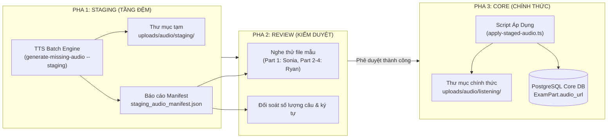

# TÀI LIỆU THIẾT KẾ KIẾN TRÚC: QUY TRÌNH STAGING & KIỂM DUYỆT DỮ LIỆU
## DỰ ÁN: APTIS ESOL KỲ TÍCH (`aptis-elearning`)
> **Tác giả:** Đội ngũ Kỹ thuật Hệ thống  
> **Ngày lập:** 11/10/2026  
> **Phiên bản:** v1.0.0 — Data Integrity & Staging Architecture  
> **Nguyên tắc kỹ thuật:** Bám sát 100% hiện trạng PostgreSQL & Prisma ORM. Đảm bảo an toàn dữ liệu, chống ghi đè đột ngột.

---

## 1. MỤC TIÊU THIẾT KẾ (DESIGN OBJECTIVES)

1. **Bảo vệ tuyệt đối Core Database:** Không để bất kỳ batch script tự động nào ghi trực tiếp vào các bảng quan trọng (`ExamPart`, `Question`, `ExamSubmission`, `User`) mà không có bước đệm và sự phê duyệt.
2. **Minh bạch hóa quy trình (Auditable & Traceable):** Mọi tài nguyên sinh tự động (file âm thanh MP3, đề thi import) đều phải có file báo cáo đối soát (**Manifest**) ghi nhận rõ mã định danh, nguồn gốc, dung lượng và kết quả kiểm thử.
3. **Quy trình 3 pha (3-Phase Pipeline):**
   $$\text{STAGING (Tầng Đệm)} \longrightarrow \text{REVIEW (Kiểm Duyệt / Thử Nghiệm)} \longrightarrow \text{CORE (Đồng Bộ Chính Thức)}$$

---

## 2. KIẾN TRÚC 3 PHA CHI TIẾT THEO TỪNG MODULE



---

## 3. ĐẶC TẢ KỸ THUẬT MODULE AUDIO LISTENING

### 3.1. Cấu trúc thư mục đệm:
- Thư mục staging: `backend/uploads/audio/staging/`
- Thư mục core: `backend/uploads/audio/listening/`
- File manifest: `backend/storage/staging_audio_manifest.json`

### 3.2. Cấu trúc bản ghi trong Manifest (`staging_audio_manifest.json`):
```json
{
  "generated_at": "2026-10-11T22:45:00.000Z",
  "total_items": 961,
  "success_count": 961,
  "failed_count": 0,
  "items": [
    {
      "exam_id": "f5d923e3-xxxx-xxxx-xxxx-xxxxxxxxxxxx",
      "exam_title": "Listening trộn Red 3",
      "part_id": "part-uuid-1234",
      "part_number": 1,
      "voice": "en-GB-SoniaNeural",
      "char_count": 198,
      "staging_file_path": "uploads/audio/staging/listening_f5d923e3_p1_1728661500.mp3",
      "target_core_url": "/uploads/audio/listening/listening_f5d923e3_p1_1728661500.mp3",
      "file_size_bytes": 22320,
      "status": "STAGED",
      "verified": false
    }
  ]
}
```

### 3.3. Các lệnh điều khiển hệ thống:
1. **Lệnh 1 — Chạy Dry-Run (Chỉ kiểm tra, không sinh file):**
   ```bash
   npx ts-node -T backend/scripts/generate-missing-audio.ts --dry-run
   ```
2. **Lệnh 2 — Sinh đệm Staging (Sinh file MP3 tạm + Manifest, KHÔNG đụng DB):**
   ```bash
   npx ts-node -T backend/scripts/generate-missing-audio.ts --staging
   ```
3. **Lệnh 3 — Kiểm duyệt file mẫu:**
   Mở trực tiếp các file MP3 trong `backend/uploads/audio/staging/` để nghe thử chất lượng.
4. **Lệnh 4 — Áp dụng vào Core Database (Sau khi đã kiểm duyệt OK):**
   ```bash
   npx ts-node -T backend/scripts/apply-staged-audio.ts
   ```

---

## 4. ĐẶC TẢ MODULE ĐỀ THI MỚI (DOCX INGESTION)

- Khi nạp đề thi từ file DOCX qua `ingestion.service.ts`:
  - Bản ghi trong bảng `Exam` luôn được gán `is_published: false`.
  - Toàn bộ câu hỏi con được tạo đầy đủ để Admin có thể xem trước.
  - Trên giao diện của học viên, các truy vấn luôn có bộ lọc:
    ```typescript
    where: { is_published: true }
    ```
  - Chỉ khi Quản trị viên vào trang Quản lý đề thi (`/admin/exams`) và bấm nút **"Xuất bản"** (gọi API `PATCH /api/admin/exams/:id` với `{ isPublished: true }`), đề thi mới được công khai cho học viên.

---

## 5. ĐẶC TẢ MODULE TỪ VỰNG GOOGLE SHEET

- **Tầng đệm Client-Side:** Sử dụng Modal Xem trước (Preview Screen) tại trang `/vocabulary`.
- Quy trình:
  1. Người dùng dán link Google Sheet $\rightarrow$ Gọi API trung gian `/api/import-sheet` lấy dữ liệu CSV.
  2. Bóc tách dữ liệu và hiển thị ngay trên bảng tạm của Modal (số từ, từ vựng, phiên âm, nghĩa tiếng Việt).
  3. Người dùng rà soát nội dung.
  4. Bấm **"Xác nhận nạp"** $\rightarrow$ Hệ thống lọc trùng bằng `Set` và chỉ lưu các từ mới vào Sổ tay cá nhân của học viên (`localStorage` & SRS Flashcard).
  5. Tuyệt đối không làm thay đổi ngân hàng từ vựng chung của hệ thống.
