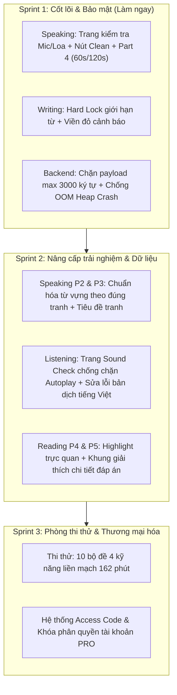

# 📋 BẢNG THEO DÕI VÀ PHÁT TRIỂN TÍNH NĂNG APTIS E-LEARNING

> **Quy ước đánh dấu trạng thái:**
> - `[ ]` : Chưa bắt đầu (Pending)
> - `[/]` : Đang phát triển / Đang xử lý (In Progress)
> - `[x]` : Đã hoàn thành (Done)
>
> **Mức độ ưu tiên:**
> - 🔴 `[P0 - Ưu tiên cao / Làm trước]`
> - 🟡 `[P1 - Ưu tiên trung bình]`
> - 🟢 `[P2 - Mở rộng / Cải tiến sau]`

---

## 🛡️ KỶ LUẬT PHÁT TRIỂN & QUY TẮC CODE CLEAN (BẮT BUỘC)

> [!IMPORTANT]
> **1. NGUYÊN TẮC "KHÔNG PHỎNG ĐOÁN - KHÔNG FALLBACK BỪA BÃI":**
> - **Tuyệt đối không đoán mò dữ liệu:** Không tự ý bịa mock data, không gán cứng (hardcode) fallback hình ảnh, từ vựng hay đáp án không có căn cứ.
> - **Single Source of Truth:** Dữ liệu bài tập, hình ảnh, từ vựng gợi ý phải lấy trực tiếp và chuẩn xác từ Database / API.
>
> **2. CƠ CHẾ "CODE CHỜ" (CLEAN PLACEHOLDER / PENDING STATE):**
> - Nếu một phần tính năng hoặc dữ liệu **chưa rõ nghiệp vụ hoặc chưa có dữ liệu thật trong DB**:
>   - Viết code ở dạng **chờ sạch sẽ** (Clean Pending / Graceful State), có cờ kiểm tra dữ liệu rõ ràng.
>   - Giao diện hiển thị trạng thái chuẩn: *`"Đang cập nhật nội dung..."`* hoặc skeleton gọn gàng, không render dữ liệu rác gây hiểu lầm cho học viên.
>   - Đánh dấu comment chuẩn: `// PENDING_USER_CONFIRMATION: [Mô tả chi tiết câu hỏi cần chốt]`.
>
> **3. QUY TRÌNH CONFIRM VỚI USER TRƯỚC KHI LÀM:**
> - Mọi điểm phân vân về mặt luồng người dùng (UX flow), tham số cấu hình hoặc dữ liệu chưa đủ đều phải được ghi chép vào mục **"DANH SÁCH CẦN CONFIRM VỚI USER"** bên dưới để trao đổi và chốt phương án với User trước khi code, tuyệt đối không tự ý quyết định thay User.

---

## 🎨 QUY CHUẨN MICROCOPY NÚT BẤM (CLEAN & HUMAN UI)

| Giai đoạn | Nhãn cũ / Máy móc | **Nhãn chuẩn mới (Clean UI)** | Icon đề xuất | Hành vi |
| :--- | :--- | :--- | :--- | :--- |
| **Chờ vào bài** | "Bắt đầu làm bài đếm giờ" | **Bắt đầu** | `▶` Play | Bắt đầu chạy thời gian chuẩn bị |
| **Chủ động nói** | "Tôi đã sẵn sàng nói ngay (120s)" | **Sẵn sàng** | `🎙️` Mic | Bỏ qua thời gian chuẩn bị, kích hoạt mic nói ngay |
| **Đang chuẩn bị** | "Tùy chỉnh thời gian: Tạm dừng" | **Tạm dừng** / **Tiếp tục** | `⏸` / `▶` | Toggle dừng / chạy tiếp đồng hồ chuẩn bị |
| **Đang ghi âm** | "Finish Recording" / "Nộp bài nói sớm" | **Hoàn thành** | `⏹` Check | Nộp bài nói sớm khi hoàn thành phát biểu |
| **Tạm dừng nói** | *(Chưa có)* | **Tạm dừng** / **Tiếp tục** | `⏸` / `▶` | Tạm ngưng cả timer và MediaRecorder |
| **Làm lại bản thu** | "Làm lại từ đầu câu này" | **Thu lại** | `🔄` Rotate | Hủy bản thu lỗi, làm lại từ đầu câu hỏi |
| **Sau khi thu** | "Nghe lại bản thu âm của bạn" | **Nghe lại** | `▶` Play | Phát lại bản ghi âm vừa nói |
| **Chuyển câu** | "Chuyển sang câu tiếp theo" | **Câu tiếp** | `→` Arrow | Chuyển sang câu hỏi kế tiếp |

---

## 🎙️ PHẦN I: SPEAKING (KỸ NĂNG NÓI)

### 1. Trang chuẩn bị trước khi vào bài (Onboarding / Device Check)
*Mục đích: Xóa bỏ hoàn toàn tình trạng vừa bấm vào đề là đồng hồ tự đếm ngược và micro tự bật, giúp học viên làm chủ 100% thời điểm bắt đầu; đồng thời kiểm tra phần cứng (micro + loa) tránh lỗi ghi âm câm.*
- [x] 🔴 **[P0 - UI/UX]** Xây dựng **Trang chuẩn bị thiết bị (Device Check Screen)** trước khi vào Part 1:
  - [x] Hiển thị thông tin tổng quan đề thi: Tiêu đề đề, cấu trúc 4 phần, tổng thời gian (~12 phút).
  - [x] **Khối 1 - Kiểm tra Microphone:**
    - Nút bấm: `[ Kiểm tra microphone ]`.
    - Xin quyền MediaDevices từ trình duyệt, kiểm tra luồng audio live.
    - Hiển thị trạng thái tích xanh: `✓ Microphone sẵn sàng!` khi thành công.
  - [x] **Khối 2 - Kiểm tra Âm thanh (Loa / Tai nghe):**
    - Nút bấm: `[ Nghe thử tiếng bíp ]`.
    - Dùng Web Audio API phát tiếng bíp chuẩn của phòng thi Aptis để học viên kiểm tra âm lượng.
    - Hiển thị trạng thái tích xanh: `✓ Đã phát tiếng bíp. Nếu không nghe thấy, hãy tăng âm lượng.`
  - [x] **Nút điều hướng bắt đầu:**
    - Nút `[ Start Assessment ]` (hoặc `[ Bắt đầu ]`): Chỉ sáng lên khi đã kiểm tra thiết bị.
    - Cho phép nút phụ `[ Vào nhanh ]` (Bỏ qua kiểm tra) cho học viên đã từng cấp quyền để không gây phiền khi luyện nhiều đề.
- [x] 🔴 **[P0 - UI/UX]** Xây dựng **Trang Hướng dẫn quy chế thi (Test Instructions Screen)**:
  - [x] Tóm tắt quy chế chuẩn British Council: Nghe hướng dẫn, nói sau tiếng bíp, bài thi tự động chuyển tiếp.
  - [x] Nút `[ Bắt đầu làm bài ]` ➔ Click vào mới chính thức kích hoạt Part 1.

---

### 2. Tính năng Pause & Điều khiển thời gian trong bài
- [x] 🔴 **[P0 - Hook]** Nâng cấp Hook [`use-audio-recorder.ts`](file:///d:/sontayweb/aptis-elearning/frontend/src/hooks/use-audio-recorder.ts):
  - [x] Thêm hàm `pauseRecording()`: Gọi `mediaRecorderRef.current.pause()` và dừng interval tính thời lượng.
  - [x] Thêm hàm `resumeRecording()`: Gọi `mediaRecorderRef.current.resume()` và tiếp tục tính thời lượng.
  - [x] Xuất thêm cờ trạng thái `isPaused: boolean`.
- [x] 🔴 **[P0 - State & Logic]** Cập nhật State Machine tại [`frontend/src/app/speaking/[id]/page.tsx`](file:///d:/sontayweb/aptis-elearning/frontend/src/app/speaking/[id]/page.tsx):
  - [x] Đổi type: `stage: "ready" | "prep" | "speaking" | "finished"`.
  - [x] Mặc định khi chuyển câu: Đặt `stage = "ready"` (hiển thị đề, tranh, từ vựng) thay vì tự động ép vào `"prep"` chạy giờ.
- [x] 🔴 **[P0 - UI]** Bổ sung nút bấm điều khiển cho **TẤT CẢ các Part (Part 1 ➔ Part 4)**:
  - [x] Giai đoạn Chuẩn bị (`prep`): Thêm nút `[ Tạm dừng ]` / `[ Tiếp tục ]` cho cả Part 1, Part 2, Part 3 (hiện đang thiếu).
  - [x] Giai đoạn Đang nói (`speaking`): Thêm nút `[ Tạm dừng ]` / `[ Tiếp tục ]` khi đang ghi âm.
  - [x] Giai đoạn Đang nói: Thêm nút `[ Thu lại ]` để làm lại từ đầu nếu học viên nói vấp.
  - [x] Đổi nút `Finish Recording` thành nhãn ngắn gọn: `[ Hoàn thành ]`.

---

### 3. Speaking Part 2 (Mô tả 1 tranh)
- [x] 🔴 **[P0 - Dữ liệu & AI Generator]** **Bộ công cụ quét & chuẩn hóa từ vựng gợi ý theo tranh**:
  - [x] Xây dựng service [`speaking-hints-generator.service.ts`](file:///d:/sontayweb/aptis-elearning/backend/src/modules/admin/speaking-hints-generator.service.ts) tự động phân tích ngữ cảnh tranh & prompt để sinh từ vựng B1 - B2, câu mở đầu, câu phát triển ý.
  - [x] Sinh câu lệnh tạo ảnh [`aiImagePrompts`](file:///d:/sontayweb/aptis-elearning/backend/src/tools/generate-speaking-hints-tool.ts) chuẩn Midjourney/Imagen để phục vụ kế hoạch tái tạo lại toàn bộ ảnh.
  - [x] Lưu trữ trực tiếp vào `options.vocabularyHints` trong DB PostgreSQL; ưu tiên đọc DB khi học viên làm bài (0ms latency).
- [x] 🟡 **[P1 - UI Admin]** Tích hợp Modal quản trị [`speaking-hints-modal.tsx`](file:///d:/sontayweb/aptis-elearning/frontend/src/components/admin/exams/speaking-hints-modal.tsx) tại `/admin/exams/[id]/edit`:
  - [x] Nút bấm `[ ⚡ AI Tự động sinh gợi ý ]` và form chỉnh sửa tag từ vựng, câu mẫu, prompt tạo ảnh.
  - [x] Badge hiển thị trạng thái `✨ Có gợi ý tranh` / `Chưa có gợi ý tranh` trên từng thẻ câu hỏi.

---

### 4. Speaking Part 3 (So sánh 2 tranh)
- [x] 🔴 **[P0 - Dữ liệu & AI Generator]** **Xóa bỏ triệt để hardcode Collocations & Mẫu câu so sánh đối lập**:
  - [x] Chạy unit test kiểm thử chất lượng bộ generator ([`test-speaking-hints-generator.ts`](file:///d:/sontayweb/aptis-elearning/backend/src/tools/test-speaking-hints-generator.ts)) đạt 5/5 PASS (100%).
  - [x] Tự động sinh Collocations đối lập tương ứng với cặp tranh (VD: *human endurance vs mechanical power, stark difference in pace*).
  - [x] Tự động sinh mẫu câu so sánh & đối chiếu (Compare & Contrast).
  - [x] Tự động sinh Prompt ảnh 1 và Prompt ảnh 2 cho AI gen lại ảnh.
  - [x] Kết nối hiển thị động tại [`frontend/src/app/speaking/[id]/page.tsx`](file:///d:/sontayweb/aptis-elearning/frontend/src/app/speaking/[id]/page.tsx#L1214-L1230).
- [x] 🟡 **[P1 - UI Admin]** Nút `[ 🤖 AI Gợi ý Part 2 & 3 ]` trên thanh công cụ trang sửa đề cho phép sinh hàng loạt 1-click.

---

### 5. Speaking Part 4 (Thảo luận 3 câu hỏi - Mô hình Lai tối ưu)
- [x] 🔴 **[P0 - Flow & Timer]** Cấu hình chuẩn: **1 phút (60s) chuẩn bị + 2 phút (120s) nói**:
  - [x] Khi mở Part 4: Ở trạng thái `ready` (hiển thị đầy đủ chủ đề, 3 câu hỏi phụ, ô nháp, từ vựng gợi ý).
  - [x] Cung cấp 2 lựa chọn vào bài:
    - [x] `[ Bắt đầu ]`: Đếm ngược 60s chuẩn bị ➔ Hết 60s phát tiếng Beep ➔ Tự động bật micro và đếm ngược 120s nói (Format chuẩn thi thật).
    - [x] `[ Sẵn sàng ]`: Bỏ qua 60s chuẩn bị, bật micro và đếm lùi 120s nói ngay lập tức (Dành cho người đã có dàn ý nhanh).
  - [x] Trong lúc đếm 60s: Có nút `[ Tạm dừng ]` / `[ Tiếp tục ]` và nút `[ Sẵn sàng ]` nói luôn.
  - [x] Trong lúc nói 120s: Có nút `[ Hoàn thành ]` để nộp bài sớm nếu nói xong ở 1p40s (không bắt chờ hết 2 phút).
  - [x] Trong lúc nói 120s: Có nút `[ Thu lại ]` để làm lại từ đầu nếu gặp sự cố.

---

## ✍️ PHẦN II: WRITING (KỸ NĂNG VIẾT)

### 1. Trang chuẩn bị trước khi vào bài Writing
- [x] 🟡 **[P1 - UI]** Xây dựng **Trang tổng quan & quy chế Writing** ([`writing-intro-screen.tsx`](file:///d:/sontayweb/aptis-elearning/frontend/src/components/writing/writing-intro-screen.tsx)):
  - [x] Tóm tắt thời gian tổng: 50 phút.
  - [x] Tóm tắt 4 Part và hạn mức từ từng phần (`10 / 45 / 60 / 75 / 225 từ`).
  - [x] Cảnh báo: *"Hệ thống sẽ khóa nhập liệu khi chạm ngưỡng từ tối đa. Hãy phân bổ thời gian hợp lý (gợi ý: 20 phút cho Part 4)."*
  - [x] Nút `[ Bắt đầu ]` / `[ Vào nhanh ]` để người dùng chủ động kích hoạt đồng hồ 50 phút.

---

### 2. Khóa giới hạn số từ (Word Limit Hard Lock)
- [x] 🔴 **[P0 - Logic]** Cấu hình hạn mức từ tối đa (Max Words) cho từng phần:
  - [x] **Part 1:** Tối đa `10 từ` / câu (5 câu hỏi ngắn).
  - [x] **Part 2:** Tối đa `45 từ` / bài.
  - [x] **Part 3:** Tối đa `60 từ` / câu (3 câu hỏi hội thoại).
  - [x] **Part 4 - Thư thân mật (Email 1):** Tối đa `75 từ`.
  - [x] **Part 4 - Thư trang trọng (Email 2):** Tối đa `225 từ`.
- [x] 🔴 **[P0 - UX/UI]** Trải nghiệm khóa từ thông minh & Báo đỏ:
  - [x] Xây dựng helper `enforceWordLimit(newVal, oldVal, maxWords)`:
    - Cho phép gõ bình thường khi chưa chạm ngưỡng `maxWords`.
    - Khi chạm đúng `maxWords`: Chặn không nhận thêm ký tự / khoảng trắng làm phát sinh từ thứ `maxWords + 1`.
    - **Không khóa cứng phím xóa:** Luôn cho phép `Backspace`, `Delete`, phím mũi tên và bôi đen để sửa/xóa từ cũ.
    - Xử lý khi dán văn bản (`Paste`): Tự động cắt gọn đúng `maxWords` từ đầu tiên.
  - [x] Hiển thị trực quan:
    - Viền textarea đổi sang màu đỏ cảnh báo: `border-destructive ring-1 ring-destructive`.
    - Bộ đếm từ đổi màu đỏ: `10 / 10 từ (Đã đạt giới hạn tối đa)`.
- [x] 🟡 **[P1 - UI]** Gắn **sticker / nhãn phân biệt độ ưu tiên** (`☘️` Cỏ may mắn) cho danh sách đề Writing.

---

### 3. Bảo vệ Backend (Security & Anti-OOM Crash)
*Mục đích: Ngăn chặn triệt để nguy cơ người dùng hoặc script độc hại gửi POST một đoạn text hàng triệu ký tự / hàng chục nghìn dòng làm sập bộ nhớ Heap Node.js (FATAL ERROR: JavaScript heap out of memory).*
- [x] 🔴 **[P0 - DTO Validation]** Cập nhật [`backend/src/modules/submissions/submission.dto.ts`](file:///d:/sontayweb/aptis-elearning/backend/src/modules/submissions/submission.dto.ts):
  - [x] Khóa độ dài tối đa chuỗi bài viết: `textAnswer: z.string().max(3000, "Bài viết vượt quá giới hạn 3,000 ký tự").nullable().optional()`.
  - [x] Khóa số lượng phần tử mảng câu trả lời: `answers: z.array(...).max(50, "Không được gửi quá 50 câu trả lời trong một lần autosave")`.
  - [x] Khóa độ dài `selectedOption`: `z.string().max(20).nullable().optional()`.
- [x] 🔴 **[P0 - Service Defense]** Cập nhật [`backend/src/modules/ai-grading/ai-grading.service.ts`](file:///d:/sontayweb/aptis-elearning/backend/src/modules/ai-grading/ai-grading.service.ts):
  - [x] Cắt chuỗi an toàn trước khi xử lý: `const safeText = (ans.text_answer || '').slice(0, 3000);`.
  - [x] Đổi cách đếm từ: Dùng regex an toàn `(safeText.match(/\S+/g) || []).length` thay vì gọi `split(/\s+/)` trên chuỗi khổng lồ.
  - [x] Đảm bảo text truyền vào prompt OpenAI/Gemini không vượt quá token context để tránh lỗi 400 hoặc tốn chi phí API.
- [x] 🟡 **[P1 - Rate Limiting]** Thêm `autosaveRateLimiter` (60 requests/phút/user) cho endpoint `PUT /api/submissions/:id/autosave` tại [`rate-limit.middleware.ts`](file:///d:/sontayweb/aptis-elearning/backend/src/middlewares/rate-limit.middleware.ts) và [`submission.routes.ts`](file:///d:/sontayweb/aptis-elearning/backend/src/modules/submissions/submission.routes.ts) để chặn spam bot tự động.

---

## 🎧 PHẦN III: LISTENING (KỸ NĂNG NGHE)

### 1. Trang chuẩn bị trước khi vào bài Listening (Sound Check & Anti-Autoplay Lock)
*Mục đích: Khắc phục 100% chính sách Autoplay Policy của trình duyệt (Chrome/Safari chặn âm thanh khi vừa load trang), giúp học viên kiểm tra tai nghe/loa trước khi vào bài để không bị mất lượt nghe (mỗi câu chỉ được nghe 2 lần).*
- [x] 🔴 **[P0 - UX/UI]** Xây dựng **Trang Onboarding & Sound Check** tại [`frontend/src/app/listening/[id]/page.tsx`](file:///d:/sontayweb/aptis-elearning/frontend/src/app/listening/[id]/page.tsx):
  - [x] State Machine: Thêm trạng thái `stage: "sound_check" | "testing" | "review"`.
  - [x] Khối 1 - Thông tin tổng quan đề thi: Tiêu đề đề, 4 phần thi, 25 câu hỏi, tổng thời gian (40 phút).
  - [x] Khối 2 - Kiểm tra âm thanh (Sound Test):
    - Nút bấm: `[  Nghe thử âm thanh ]`.
    - Sử dụng Web Audio API hoặc audio mẫu 3s phát câu test chuẩn Aptis: *"This is a sound check for the Aptis listening test."*
    - Hiển thị thanh chỉnh âm lượng và badge tích xanh: `✓ Âm thanh rõ ràng! Hãy điều chỉnh âm lượng vừa nghe.`
  - [x] Khối 3 - Quy chế phòng thi chuẩn British Council:
    - *"Mỗi đoạn ghi âm chỉ được phát tối đa 2 lần."*
    - *"Không chuyển tab trong khi nghe để tránh mất lượt phát."*
    - *"Thời gian làm bài 40 phút sẽ bắt đầu tính khi bạn bấm nút Bắt đầu."*
  - [x] Nút điều hướng:
    - Nút chính: `[ Bắt đầu làm bài ]` (Chỉ sáng sau khi đã bấm nghe thử hoặc xác nhận thiết bị).
    - Nút phụ: `[ Vào nhanh ]` (Bỏ qua kiểm tra dành cho học viên luyện tập nhiều đề liên tục).

---

### 2. Sửa lỗi Hiển thị Bản dịch Tiếng Việt (Transcript & Translation VI)
- [x] 🔴 **[P0 - Bug Fix]** Chuẩn hóa hiển thị Transcript song ngữ khi xem lại bài (Review Mode):
  - [x] Kiểm tra API Backend: Đảm bảo trường `passage_text` (Transcript tiếng Anh) và `translation_vi` (nếu có) được trả về trong payload xem lại bài.
  - [x] Giao diện Review Mode: Bổ sung 2 tab chuyển đổi: `[ 🇬🇧 Lời thoại tiếng Anh ]` và `[ 🇻🇳 Bản dịch Tiếng Việt ]`.
  - [x] Cơ chế chờ sạch (Graceful State): Nếu câu nào trong DB chưa có bản dịch tiếng Việt, hiển thị nhãn nhẹ nhàng: *`"Đang cập nhật bản dịch tiếng Việt cho câu này..."`*, tuyệt đối không hiển thị khung rỗng hay chữ `undefined`.

---

### 3. Quản lý Âm thanh & Bộ công cụ AI Sinh Giọng nói từ Kịch bản (Hybrid Audio Management)
- [x] 🔴 **[P0 - Backend API]** Xây dựng các Endpoint quản lý Audio đề thi:
  - [x] `POST /api/admin/exams/upload-audio`: Kéo thả tải file audio (.mp3, .wav, .m4a, .ogg, .webm) kèm cơ chế tự động dọn dẹp file cũ khi thay thế.
  - [x] `POST /api/admin/exams/delete-audio` & `adminService.safeDeleteExamAudio`: Xóa an toàn audio khỏi máy chủ, bảo vệ 100% chống Path Traversal.
  - [x] `POST /api/admin/exams/generate-audio-tts`: 1-Click AI TTS tự động sinh giọng đọc bản ngữ Anh - Anh từ Transcript/Script, tự động nhận diện kịch bản hội thoại để phân vai Nam (Ryan) & Nữ (Sonia) luân phiên.
- [x] 🔴 **[P0 - Automated Unit Test]** Chạy bộ kiểm thử tự động [`test-listening-audio-tts.ts`](file:///d:/sontayweb/aptis-elearning/backend/src/tools/test-listening-audio-tts.ts) đạt **5/5 PASS (100%)**:
  - [x] Test 1: Sinh audio độc thoại Part 1/4 (Announcement) bằng giọng British Council (Ryan) -> PASS.
  - [x] Test 2: Tự động phân vai & sinh hội thoại 2 người Nam (Ryan) + Nữ (Sonia) Part 3 -> PASS.
  - [x] Test 3: Tùy chọn chỉ định giọng nữ Sonia -> PASS.
  - [x] Test 4: Cơ chế dọn dẹp audio cũ an toàn & Chặn đứng tấn công Path Traversal -> PASS.
  - [x] Test 5: Validation kịch bản rỗng -> PASS.
- [x] 🔴 **[P0 - Frontend UI]** Component Quản lý Âm thanh chuyên nghiệp [`audio-upload-input.tsx`](file:///d:/sontayweb/aptis-elearning/frontend/src/components/admin/audio-upload-input.tsx):
  - [x] Tích hợp 3 Tab linh hoạt: `Tải file lên` (kéo thả MP3/WAV/M4A), `AI Sinh từ Script` (1-click, chọn giọng Ryan/Sonia/Tự động), `Dán URL` (link ngoài).
  - [x] Tích hợp trực tiếp vào trình soạn đề [`part-media-editor.tsx`](file:///d:/sontayweb/aptis-elearning/frontend/src/components/admin/exams/part-media-editor.tsx): Tự động lấy text kịch bản từ ô `Passage text` để tạo âm thanh tức thì.
  - [x] Trình phát Live Preview: Nghe thử trực tiếp trên trang admin, copy link, badge trạng thái lưu server, nút xóa/thay thế dọn dẹp file tự động.

---

## 📖 PHẦN IV: READING (KỸ NĂNG ĐỌC)

### 1. Trang chuẩn bị trước khi vào bài Reading
- [x] 🟡 **[P1 - UI]** Xây dựng **Trang hướng dẫn thao tác Reading** ([`reading-intro-screen.tsx`](file:///d:/sontayweb/aptis-elearning/frontend/src/components/reading/reading-intro-screen.tsx)):
  - [x] Tóm tắt 4 phần thi & thời gian làm bài (35 phút).
  - [x] Hướng dẫn thao tác tương tác: Chọn từ ở Part 1, kéo thả câu ở Part 2, nối ý ở Part 3, highlight dẫn chứng ở Part 4.
  - [x] Nút `[ Bắt đầu ]` / `[ Vào nhanh ]`.

---

### 2. Điều khiển thời gian làm bài (Pause / Resume cho Reading)
- [x] 🔴 **[P0 - Feature]** Bổ sung nút **Pause / Resume** thời gian làm bài tại [`frontend/src/app/reading/[id]/page.tsx`](file:///d:/sontayweb/aptis-elearning/frontend/src/app/reading/[id]/page.tsx):
  - [x] Thêm state `isPaused` và gắn vào timer `useEffect`: Đóng băng đồng hồ 35 phút khi học viên nhấn Tạm dừng.
  - [x] Thêm nút bấm điều khiển `[ ⏸ Tạm dừng / ▶ Tiếp tục ]` cạnh đồng hồ thời gian trên Header bar (hoặc cạnh nút Gắn cờ).
  - [x] Đồng bộ hóa cơ chế tạm dừng như Speaking, Listening và Writing.

---

### 3. Cải tiến Reading Part 4 & Sửa lỗi hiển thị đè (Overlap) Toolbar
- [x] 🔴 **[P0 - UX/UI]** Đổi tên nhãn thao tác:
  - [x] Đổi chữ `[ ● Dẫn chứng ]` trên thanh công cụ bôi đen thành **`[ 🖍️ Highlight ]`** (Màu vàng highlight trực quan).
- [x] 🔴 **[P0 - Bug Fix]** Khắc phục lỗi **hiển thị đè (Overlap) 2 thanh công cụ khi bôi đen**:
  - [x] Nguyên nhân: Component toàn cục [`selection-translator.tsx`](file:///d:/sontayweb/aptis-elearning/frontend/src/components/selection-translator.tsx) (trong `layout.tsx`) và menu nổi riêng của Reading (`reading/[id]/page.tsx:2020`) cùng kích hoạt tại cùng tọa độ chuột `(x, y)`, làm nút gradient đỏ-cam `[ 文A Dịch nhanh ]` đè thẳng lên toolbar của bài đọc.
  - [x] Giải pháp: Thêm cờ `data-no-global-selection` cho container bài đọc Reading để `SelectionTranslator` tự động bỏ qua khi bôi đen trong bài đọc, giúp thanh công cụ Highlight hiển thị sạch sẽ, độc lập, không bị đè.
- [x] 🔴 **[P0 - Nội dung & UI]** Thêm **Giải thích đáp án**:
  - [x] Thêm khung hiển thị giải thích chi tiết phía dưới từng câu trả lời khi xem kết quả / đáp án.
  - [x] Liên kết câu giải thích với vị trí câu dẫn chứng được highlight trong đoạn văn.

---

### 4. Đồng bộ hóa tính năng Gắn cờ (Flag) & Bookmark (Đánh dấu câu hỏi)
- [x] 🔴 **[P0 - Consistency & Bug Fix]** Thống nhất nghiệp vụ "Mark for Review" trên tất cả các kỹ năng:
  - [x] Bản chất: "Gắn cờ" (Reading) và "Bookmark" (Listening/Writing) hoàn toàn cùng 1 mục đích (đánh dấu câu hỏi cần xem lại trước khi nộp bài).
  - [x] Sửa nút Bookmark trong Listening và Writing: Bổ sung state `flaggedStages` / `flaggedParts` và gắn `onClick` để khi bấm sẽ đổi màu nút (Active) và hiện biểu tượng cờ vàng dưới thanh Dock câu hỏi ở chân trang.
  - [x] Thống nhất nhãn tiếng Việt chuẩn: **"Gắn cờ"** / **"Đã gắn cờ"** trên toàn hệ thống (Listening, Reading, Writing).

---

### 5. Cải tiến Reading Part 5
- [x] 🔴 **[P0 - Nội dung & UI]** Thêm **Giải thích đáp án**:
  - [x] Cập nhật dữ liệu lý do chọn đáp án / ngữ pháp / từ vựng vào Database cho Part 5.
  - [x] Hiển thị khung giải thích chi tiết ở dưới câu hỏi khi nộp bài hoặc bấm xem đáp án.

---

### 6. Kết nối trường Lời giải thích (Explanation) trong Reading
- [x] 🔴 **[P0 - Fix Flow]** Khắc phục lỗi `reading/[id]/page.tsx` bỏ rơi trường `explanation`:
  - [x] Cập nhật interface trong [`frontend/src/data/reading-benchmark.ts`](file:///d:/sontayweb/aptis-elearning/frontend/src/data/reading-benchmark.ts): Bổ sung `explanation?: string | null` vào `Part1Gap`, `Part2Story`, `Part3Question`, `Part4Paragraph`.
  - [x] Sửa hàm `parseApiToReadingData` trong [`frontend/src/app/reading/[id]/page.tsx`](file:///d:/sontayweb/aptis-elearning/frontend/src/app/reading/[id]/page.tsx): Map đầy đủ `explanation: q.explanation` cho cả 4 Part.
  - [x] Bổ sung khối UI hiển thị **"Lời giải thích của giáo viên / Dẫn chứng"** khi học viên nộp bài xem kết quả (Review Mode) - Chỉ hiển thị khi có nội dung, nếu câu nào chưa có thì ẩn hoàn toàn.

---

## 🏛️ PHẦN V: PHÒNG THI THỬ & TÀI KHOẢN PRO (MOCK TEST ROOM)

### 1. Ngân hàng Đề Thi Thử Full Test Hoàn Chỉnh (Database & Đề Chuẩn)
- [x] 🔴 **[P0 - Dữ liệu thực]** Khởi tạo & nạp ngân hàng đề thi thử Full Test trong Database:
  - [x] Đã nạp **51 bộ đề Full Test hoàn chỉnh**:
    - 20 đề mã chuẩn `[APT-01]` đến `[APT-20]` (16 parts, 150 phút).
    - 24 đề chuẩn `Kỳ Tích 01` đến `Kỳ Tích 26` (22 parts, 162 phút chuẩn British Council).
  - [x] Phân tầng truy cập: Các đề 01, 02, 03 mở miễn phí (Free), từ đề 04 trở đi gắn cờ VIP/PRO (`is_pro: true`).
- [x] 🔴 **[P0 - Frontend Danh sách]** Trang trung tâm danh sách đề thi thử [`/thi-thu`](file:///d:/sontayweb/aptis-elearning/frontend/src/app/thi-thu/page.tsx):
  - [x] Hiển thị thẻ đề thi với thông số chi tiết: Số phần thi, số câu hỏi, độ hot, thời lượng, tag đề tủ.
  - [x] Icon ổ khóa 🔒 tự động gắn trên các đề `is_pro: true` nếu học viên dùng tài khoản Free.
  - [x] Modal popup nâng cấp VIP / nhập mã khi click vào đề thi bị khóa.

---

### 2. Hệ Thống Mã Đề Thi Thử & Mã Kích Hoạt VIP (`PromotionCode` & `RoomCode`)
*Mục đích: Cho phép học viên nhập mã đề (`APT-01` → `APT-20`) hoặc mã kích hoạt VIP trải nghiệm (`PromotionCode`), đồng thời Admin quản trị, khởi tạo và trộn ngẫu nhiên 20 bộ đề Full Test.*
- [x] 🔴 **[P0 - Database Model]** Model `PromotionCode` & `PromotionRedemption` trong [`schema.prisma`](file:///d:/sontayweb/aptis-elearning/backend/prisma/schema.prisma) + bộ tạo 20 đề Full Test [`fulltest-generator.ts`](file:///d:/sontayweb/aptis-elearning/backend/src/modules/exams/fulltest-generator.ts).
- [x] 🔴 **[P0 - Backend & Admin API]** Xác thực mã đề, kích hoạt mã VIP (`POST /api/payment/redeem-code`), khôi phục 20 đề Full Test (`POST /api/admin/exams/generate-fulltests`) và trộn lại ngẫu nhiên 16 Parts (`POST /api/admin/exams/:id/rerandomize`).
- [x] 🔴 **[P0 - Frontend & Admin UI]** Ô nhập mã đề nhanh & Modal VIP PRO tại [`frontend/src/app/thi-thu/page.tsx`](file:///d:/sontayweb/aptis-elearning/frontend/src/app/thi-thu/page.tsx) + Nút quản trị Full Test tại [`frontend/src/app/admin/exams/page.tsx`](file:///d:/sontayweb/aptis-elearning/frontend/src/app/admin/exams/page.tsx).

---

### 3. Quy Trình Thi Thử Liên Hoàn Chuẩn 162 Phút (British Council Simulation)
- [x] 🔴 **[P0 - Flow & Timer]** Phòng thi thử liên hoàn 4 kỹ năng (16 Parts) tại [`frontend/src/app/thi-thu/[id]/page.tsx`](file:///d:/sontayweb/aptis-elearning/frontend/src/app/thi-thu/[id]/page.tsx):
  - [x] Màn hình kiểm tra thiết bị (Loa + Micro) trước khi bấm Bắt đầu kích hoạt đồng hồ tổng.
  - [x] Cơ chế khóa phòng thi: Trong phòng thi thử Full Test, vô hiệu hóa nút Pause (không cho tạm dừng) để đảm bảo tính nghiêm túc đúng áp lực phòng thi thật.
  - [x] Tự động autosave khi chuyển câu, đồng bộ Heartbeat mỗi 30 giây và tự động nộp bài khi hết giờ.

---

## 🎓 PHẦN VI: LUỒNG LỜI GIẢI THÍCH CỦA GIÁO VIÊN & BỘ ĐỀ THEO CHỦ ĐỀ (TEACHER EXPLANATION & TOPIC QUESTIONS)

### 1. Báo cáo kiểm toán luồng kỹ thuật hiện tại (Current Architecture Audit)
*Kiểm tra đối soát mã nguồn ngày 31/10/2026:*
- **Tầng 1 - Database (Prisma):**
  - Model `Question` tại [`schema.prisma:216`](file:///d:/sontayweb/aptis-elearning/backend/prisma/schema.prisma#L216) **ĐÃ CÓ SẴN** trường `explanation String?` (Lời giải thích chi tiết / dẫn chứng / bài mẫu).
- **Tầng 2 - Backend API & Services:**
  - `admin.dto.ts` & `admin.service.ts`: Đã hỗ trợ CRUD trường `explanation` (`createExam`, `updateQuestion`, `addQuestion`).
  - `submission.service.ts`: `getSubmissionDetail` đã nạp đầy đủ `explanation` khi trả về kết quả bài nộp cho học viên xem lại.
  - `exam.service.ts`: Đã có cơ chế bảo mật xóa `explanation` và `correct_answer` khi học viên đang làm bài thi để chống gian lận.
  - ⚠️ **Điểm nghẽn Backend:** Route `PATCH /api/admin/questions/:id` và `POST /api/admin/exams` đang bị khóa cứng bởi `roleGuard(['ADMIN'])`. Tài khoản có role `TEACHER` hiện **CHƯA ĐƯỢC PHÂN QUYỀN** để thêm/sửa lời giải thích câu hỏi.
- **Tầng 3 - Giao diện Soạn thảo (Admin/Teacher Portal):**
  - Đã có component [`polymorphic-question-form.tsx`](file:///d:/sontayweb/aptis-elearning/frontend/src/components/admin/exams/polymorphic-question-form.tsx) với ô Textarea nhập `explanation` theo từng kỹ năng.
  - ⚠️ **Điểm nghẽn Giao diện:** Form này hiện chỉ Admin vào được tại `/admin/exams/[id]/edit`. Giao diện Giáo viên (`/teacher`) hoàn toàn **chưa có trang quản trị đề / câu hỏi** để giáo viên nhập lời giải thích.
- **Tầng 4 - Giao diện Học viên (Student View):**
  - `Grammar` & `Listening`: Đã có khối UI hiển thị `explanation` khi nộp bài.
  - `Speaking` & `Writing`: Đã hiển thị `explanation` dưới dạng "Bài mẫu tham khảo".
  - ⚠️ **Điểm nghẽn Giao diện:** Kỹ năng **Reading (`/reading/[id]`)** đang bỏ rơi 100% trường `q.explanation` trong hàm `parseApiToReadingData` và chưa có khối hiển thị lời giải thích sau khi làm bài.

---

### 2. Luồng Admin / SuperAdmin soạn & sửa lời giải thích (Hoàn thiện trước)
- [x] 🔴 **[P0 - Admin Backend]** API cập nhật câu hỏi cho Admin / SuperAdmin:
  - [x] `PATCH /api/admin/questions/:questionId`: Xử lý lưu chuẩn trường `explanation`, tự động `.trim()` và chuyển chuỗi rỗng thành `null` khi xóa.
  - [x] Phân quyền tự động cho `ADMIN` và `SUPER_ADMIN` qua `roleGuard`.
- [x] 🔴 **[P0 - Admin UI Editor]** Trình soạn thảo câu hỏi chuyên nghiệp tại `/admin/exams/[id]/edit`:
  - [x] Nâng cấp [`polymorphic-question-form.tsx`](file:///d:/sontayweb/aptis-elearning/frontend/src/components/admin/exams/polymorphic-question-form.tsx): Chuyển toàn bộ các ô nhập giải thích (Gap Fill, Matching, Multiple Choice,...) thành `<textarea>` đa dòng, hỗ trợ viết giải thích chuyên sâu nhiều ý/dòng.
  - [x] Nâng cấp [`question-card-row.tsx`](file:///d:/sontayweb/aptis-elearning/frontend/src/components/admin/exams/question-card-row.tsx): Thêm badge định danh trực quan `[ ✨ Có giải thích ]` hoặc `[ Chưa có giải thích ]` trên từng thẻ câu hỏi giúp Admin/SuperAdmin kiểm soát tiến độ soạn đề cực nhanh.
  - [x] Xây dựng Popup modal chuyên dụng [`question-explanation-modal.tsx`](file:///d:/sontayweb/aptis-elearning/frontend/src/components/admin/exams/question-explanation-modal.tsx): Mở nhanh trực tiếp từ nút `[ ✨ Giải thích ]` / `[ ✨ Thêm giải thích ]` trên từng thẻ câu hỏi mà không cần mở toàn bộ form sửa cồng kềnh; hỗ trợ xem trước đề + đáp án đúng, bộ đếm từ, thẻ tag mẫu nhanh (*Dẫn chứng, Ngữ pháp, Từ vựng, Loại trừ*), phím tắt `Ctrl/Cmd + Enter` để lưu.
  - [x] Tích hợp Popup modal vào [`frontend/src/app/admin/exams/[id]/edit/page.tsx`](file:///d:/sontayweb/aptis-elearning/frontend/src/app/admin/exams/[id]/edit/page.tsx): Gọi API Admin cập nhật trường `explanation`, cập nhật ngay lập tức badge trạng thái trên UI mà không cần tải lại trang.
  - [x] Sửa lỗi xóa giải thích: Khi Admin xóa trắng ô giải thích, hệ thống cập nhật đúng giá trị `null` về DB thay vì giữ nguyên nội dung cũ.
- [x] 🔴 **[P0 - Student UI]** Hoàn thiện hiển thị Lời giải thích trên toàn bộ các kỹ năng:
  - [x] Bổ sung khối UI hiển thị giải thích cho toàn bộ các phần của Reading (Part 1, 2, 3, 4).
  - [x] Quy tắc hiển thị nghiêm ngặt: **Nếu câu nào chưa có lời giải thích thì ẩn hoàn toàn**, tuyệt đối không hiển thị khung rỗng hay chữ placeholder giả.
  - [x] Đã làm sạch các trang `reading/[id]`, `grammar/[id]`, `grammar/marathon`, `thi-thu/[id]`.
- [x] 🟡 **[P1 - Teacher UI / Roles khác]**:
  - [x] Mở quyền `TEACHER` truy cập phân hệ Học vụ (`/admin/exams`, `/admin/exams/[id]/edit`, `/admin/key-du-doan`, `/admin/key-va-meo-thi`, `/admin/vocabulary`) tại [`admin.routes.ts`](file:///d:/sontayweb/aptis-elearning/backend/src/modules/admin/admin.routes.ts) và [`admin/layout.tsx`](file:///d:/sontayweb/aptis-elearning/frontend/src/app/admin/layout.tsx), đồng thời liên kết trực tiếp mục **Soạn Đề & Giải thích** trên thanh điều hướng Cổng Giảng Viên ([`teacher/layout.tsx`](file:///d:/sontayweb/aptis-elearning/frontend/src/app/teacher/layout.tsx)).

---

### 3. Tích hợp Bộ đề câu hỏi theo chủ đề (Topic-based Questions)
- [x] 🟡 **[P1 - Data & Tagging]** Liên kết câu hỏi với bộ quy tắc chủ đề:
  - [x] Tận dụng dịch vụ [`topic-tagger.service.ts`](file:///d:/sontayweb/aptis-elearning/backend/src/modules/admin/topic-tagger.service.ts) và trang quản trị [`/admin/key-du-doan`](file:///d:/sontayweb/aptis-elearning/frontend/src/app/admin/key-du-doan/page.tsx) để tự động hoặc gán thủ công thẻ chủ đề (Film, Singer, Technology, Travel, Environment, Social Life,...).
  - [x] Hiển thị nhãn chủ đề và mức độ Cỏ `☘️` nổi bật trên từng đề thi tại [`/key-du-doan`](file:///d:/sontayweb/aptis-elearning/frontend/src/app/key-du-doan/page.tsx).
- [x] 🟡 **[P1 - Nội dung]** Soạn thảo ngân hàng lời giải thích chi tiết theo từng chủ đề:
  - [x] Đã hoàn thiện công cụ soạn nhanh giải thích (`QuestionExplanationModal`, `QuestionEditModal`) và bộ lọc chuẩn theo từng Part (`buildPartFilterCondition` trong [`admin.service.ts`](file:///d:/sontayweb/aptis-elearning/backend/src/modules/admin/admin.service.ts)) để đội ngũ giáo viên & Admin cập nhật liên tục vào Database.

---

## 🍀 PHẦN VII: TÍNH NĂNG "KEY VÀ MẸO THI" (CHUYÊN ĐỀ DỰ ĐOÁN & ÔN NHANH 2026)

> **Quy chuẩn thiết kế:** Tuân thủ 100% Design Tokens tại [`globals.css`](file:///d:/sontayweb/aptis-elearning/frontend/src/app/globals.css) (Tone màu Brand Blue `#2563EB`, Navy `#1D4ED8`, viền slate sạch sẽ, bo góc `rounded-2xl`, hỗ trợ Dark/Light mode tự nhiên). Thay toàn bộ sticker lửa thành cỏ 4 lá `🍀`. Không code phỏng đoán bịa đặt data.

### 1. Khung Điều Hướng Tổng Thể
- [x] 🔴 **[P0 - Navigation]** Xây dựng trang trung tâm [`/key-va-meo-thi`](file:///d:/sontayweb/aptis-elearning/frontend/src/app/key-va-meo-thi/page.tsx):
  - [x] Thanh Tabs cấp 1 phân chia 4 kỹ năng: `Listening`, `Reading`, `Speaking`, `Writing`.
  - [x] Tích hợp liên kết tại [`navbar.tsx`](file:///d:/sontayweb/aptis-elearning/frontend/src/components/navbar.tsx) (desktop + mobile drawer) với nhãn `Key và Mẹo thi 🍀`.
  - [x] Kết nối banner điều hướng từ trang [`/key-du-doan`](file:///d:/sontayweb/aptis-elearning/frontend/src/app/key-du-doan/page.tsx).

### 2. Kỹ Năng Listening (Part 1 - 4)
- [x] 🔴 **[P0 - Dữ liệu thực]** Khởi tạo [`key-meo-listening-data.ts`](file:///d:/sontayweb/aptis-elearning/frontend/src/data/key-meo-listening-data.ts):
  - [x] Thu thập trọn vẹn 19 Topic hot nhất 2026 từ Google Docs thật (Câu 1 + Đáp án, Câu 2 + Đáp án, Mẹo học nhanh).
  - [x] Thu thập trọn vẹn 17 Chủ đề Câu 15 (M - W - B) từ ảnh thật (Mã Code, Dãy Nữ/Nam nói trước, Câu chuyện vè nhớ nhanh).
  - [x] Dữ liệu mẫu Part 1 (7 câu hỏi Thời gian) & Part 2 (Chủ đề 17 Bảo vệ môi trường 4 dòng transcript chi tiết).
- [x] 🔴 **[P0 - Part 1 Component]** [`part1-group-view.tsx`](file:///d:/sontayweb/aptis-elearning/frontend/src/components/key-meo-thi/part1-group-view.tsx):
  - [x] Thanh 9 tab danh mục: `01 Thời gian`, `02 Thứ / Ngày`, `03 Giá tiền`, `04 Phương tiện`, `05 Địa điểm`, `06 Nghề nghiệp`, `07 Con số`, `08 Đồ vật`, `09 Hành động` kèm nhãn `🍀 MỚI`.
  - [x] Danh sách thẻ câu hỏi 2 cột: Cột trái STT + Câu hỏi + badge MỚI; Cột phải khung pill bo tròn ĐÁP ÁN.
  - [x] Tìm kiếm realtime theo câu hỏi & đáp án.
- [x] 🔴 **[P0 - Part 2 Component]** [`part2-speaker-match-view.tsx`](file:///d:/sontayweb/aptis-elearning/frontend/src/components/key-meo-thi/part2-speaker-match-view.tsx):
  - [x] Thanh chiến thuật Strategy Tips: `01. Đọc pool đáp án ➔ 02. Bắt keyword / paraphrase ➔ 03. Loại trừ đáp án`.
  - [x] Sidebar danh sách chủ đề có nút thu gọn `<<` và hiển thị mức độ ưu tiên `🍀🍀🍀`.
  - [x] Bảng Master Cheat Sheet 3 cột: `Target Answer (kèm dịch TV)` | `Audio Script Transcript` | `Keywords & Clues`.
  - [x] Trạng thái chờ sạch (Graceful Pending) cho các chủ đề đang đợi file doc tổng hợp từ giáo viên.
- [x] 🔴 **[P0 - Part 3 Component]** [`part3-cheat-sheet-view.tsx`](file:///d:/sontayweb/aptis-elearning/frontend/src/components/key-meo-thi/part3-cheat-sheet-view.tsx):
  - [x] 3 Thẻ mẹo chiến lược: Mẹo 50% điểm, Quy ước ký hiệu (M=1, W=2, B=0), 12s thời điểm vàng bắt tai.
  - [x] 2 Chế độ hiển thị: Dạng Bảng tổng hợp (Table View) & Dạng Thẻ lật ghi nhớ (Card View).
  - [x] Chế độ Tự kiểm tra (`Hide Answers`): Ẩn đáp án/mã code để học viên tự nhẩm luyện trí nhớ.
  - [x] Bảng 5 cột chuẩn 17 chủ đề kèm badge tròn phân biệt màu sắc W (hồng), M (xanh dương), B (xanh ngọc).
- [x] 🔴 **[P0 - Part 4 Component]** [`part4-topic-view.tsx`](file:///d:/sontayweb/aptis-elearning/frontend/src/components/key-meo-thi/part4-topic-view.tsx):
  - [x] Render đầy đủ 19 Topics 2026: Header card kèm icon tai nghe + badge 2 câu + cấp độ cỏ 4 lá.
  - [x] Card Câu 1 & Card Câu 2: Câu hỏi (trái) + Badge tích xanh Đáp án đúng (phải).
  - [x] Khung Mẹo Học Nhanh `💡 MẸO HỌC NHANH`: Đoạn tóm tắt lồng ghép từ vựng tiếng Anh cốt lõi.
  - [x] Bộ lọc theo cấp độ cỏ 4 lá (`Tất cả`, `🍀🍀`, `🍀🍀🍀`, `🍀🍀🍀🍀`) và thanh tìm kiếm đa năng.

### 3. Kỹ Năng Reading, Speaking, Writing (Khung chờ sạch)
- [x] 🔴 **[P0 - Graceful Pending State]** Trạng thái chờ chuẩn mực:
  - [x] Khi học viên chuyển sang tab Reading, Speaking hoặc Writing: Hiển thị giao diện thông báo chờ lịch thiệp, không render rác, cung cấp nút chuyển nhanh sang Listening hoặc vào phòng luyện đề thực chiến.

### 4. Trang Quản Trị Cấu Hình & Đồng Bộ Dữ Liệu Admin
- [x] 🔴 **[P0 - Admin Configuration Portal]** Xây dựng trang quản trị [`/admin/key-va-meo-thi`](file:///d:/sontayweb/aptis-elearning/frontend/src/app/admin/key-va-meo-thi/page.tsx):
  - [x] Tích hợp thanh menu bên trái Admin Sidebar: Mục `Key & Mẹo Thi (Listening) [NEW]` thuộc nhóm HỌC VỤ.
  - [x] **Quản lý Part 1:** Cho phép Admin thêm mới / chỉnh sửa / xóa câu hỏi và đáp án cho 9 nhóm danh mục; bật/tắt badge `MỚI 🍀`.
  - [x] **Quản lý Part 2:** Cho phép Admin thêm/sửa chủ đề, đổi số lượng cỏ 🍀, chỉnh sửa bảng phân tích (Đáp án mục tiêu + dịch TV, Audio Script, Keywords & Clues).
  - [x] **Quản lý Part 3:** Cho phép Admin sửa mã Code (0/1/2), dãy W/M/B khi Nữ nói trước & Nam nói trước, câu chuyện mẹo vè ghi nhớ của 17 chủ đề.
  - [x] **Quản lý Part 4:** Cho phép Admin thêm mới / chỉnh sửa 19 chủ đề, đổi số lượng cỏ 🍀, sửa nội dung Câu 1 & 2 + Đáp án đúng, cập nhật khung `💡 Mẹo học nhanh`.
  - [x] **Cơ chế lưu trữ SystemSetting:** Lưu JSON cấu hình vào bảng `SystemSetting` key `KEY_MEO_LISTENING_CONFIG` với cờ `is_public: true`, đồng bộ 0ms về giao diện học viên mà không cần chạy migration cơ sở dữ liệu.
  - [x] **Hỗ trợ đa URL:** Học viên truy cập qua `https://aptisesolpremier.com/meo-thi-aptis` hoặc `/key-va-meo-thi` đều tự động tải dữ liệu tùy biến mới nhất từ Admin.

---

---

## 🧱 PHẦN VIII: CHUẨN HÓA COMPONENT GIAO DIỆN DÙNG CHUNG (SHARED DESIGN SYSTEM & COMPONENT REFACTORING)
*Mục đích: Xóa bỏ triệt để tình trạng phân mảnh styles giữa 4 kỹ năng (Listening dùng nút khối tech-btn, trong khi Reading/Writing/Speaking dùng link chữ trần; lệch bo góc tab; thiếu bộ lọc). Gom code dùng chung giúp nâng cấp giao diện về sau chỉ cần sửa 1 file duy nhất.*

- [x] 🔴 **[P0 - Atomic UI]** Tạo component Button chuẩn Design System tại [`frontend/src/components/ui/button.tsx`](file:///d:/sontayweb/aptis-elearning/frontend/src/components/ui/button.tsx):
  - [x] Hỗ trợ các biến thể: `primary` (nền xanh thương hiệu), `tech` (nền xanh Aptis glow công nghệ), `outline` (nút viền), `ghost` (nút phẳng), `secondary`.
  - [x] Kích thước chuẩn: `sm`, `md`, `lg`, `icon`.
  - [x] Hỗ trợ render component Link (`ButtonLink`) mượt mà cho Next.js router.
- [x] 🔴 **[P0 - Domain Component]** Tạo thẻ đề thi dùng chung [`skill-exam-card.tsx`](file:///d:/sontayweb/aptis-elearning/frontend/src/components/skills/skill-exam-card.tsx):
  - [x] Gom ~120 dòng code thẻ đề lặp lại ở 4 trang vào 1 component dùng chung.
  - [x] Thống nhất 100% nút CTA làm bài (`tech-btn` khối bo góc `rounded-xl` có icon `ArrowRight`) và nút Mở khóa Pro.
  - [x] Hiển thị đồng nhất: Tag Part, Badge FREE/VIP, Sticker Cỏ May Mắn ☘️, Cúp CEFR 🏆, Thanh tiến độ làm bài.
- [x] 🟡 **[P1 - Tab & Filter]** Chuẩn hóa thanh chọn Part & Bộ lọc:
  - [x] Tạo [`skill-part-tabs.tsx`](file:///d:/sontayweb/aptis-elearning/frontend/src/components/skills/skill-part-tabs.tsx): Đồng bộ bo góc `rounded-xl`, tự động sync URL query (`?tab=p1`).
  - [x] Bổ sung hàng lọc **Độ Hot Cỏ ☘️** đang bị thiếu trên trang [`speaking/page.tsx`](file:///d:/sontayweb/aptis-elearning/frontend/src/app/speaking/page.tsx).
- [x] 🟡 **[P1 - Filter & Hook]** Gom bộ lọc và state dùng chung:
  - [x] Tạo [`skill-filter-bar.tsx`](file:///d:/sontayweb/aptis-elearning/frontend/src/components/skills/skill-filter-bar.tsx): lọc Độ Hot ☘️ + lọc Trạng thái (Tất cả / Đã làm / Chưa làm) + Nguồn.
  - [x] Tạo hook [`use-skill-hub.ts`](file:///d:/sontayweb/aptis-elearning/frontend/src/hooks/use-skill-hub.ts): gom state `activeTab` và logic `syncTabFromUrl` / sự kiện `aptis:switch-skill-tab` dùng chung cho cả 4 trang.
- [x] 🟢 **[P2 - Phụ trợ]** Tạo `SkillMarathonCard` (thẻ Ngân hàng câu hỏi lẻ) và `SkillEmptyState` (khung không có đề + nút đặt lại bộ lọc) trong [`skill-exam-card.tsx`](file:///d:/sontayweb/aptis-elearning/frontend/src/components/skills/skill-exam-card.tsx).
- [x] 🔴 **[P0 - Migration]** Đã chuyển toàn bộ 4 trang trung tâm kỹ năng sang dùng bộ component chung: [`listening/page.tsx`](file:///d:/sontayweb/aptis-elearning/frontend/src/app/listening/page.tsx), [`reading/page.tsx`](file:///d:/sontayweb/aptis-elearning/frontend/src/app/reading/page.tsx), [`writing/page.tsx`](file:///d:/sontayweb/aptis-elearning/frontend/src/app/writing/page.tsx), [`speaking/page.tsx`](file:///d:/sontayweb/aptis-elearning/frontend/src/app/speaking/page.tsx).
- [x] 🟡 **[P1 - Kiểm thử]** Sau migration: `npm --prefix frontend run build` 0 lỗi (59/59 routes); đồng bộ 100% nút `tech-btn`, tab `rounded-xl`, bộ lọc Độ Hot ☘️, URL sync và khóa Pro.
- [x] 🔴 **[P0 - Bug Fix]** Hỗ trợ cờ `data-no-global-selection` trong [`selection-translator.tsx`](file:///d:/sontayweb/aptis-elearning/frontend/src/components/selection-translator.tsx) và gắn vào `<main>` tại [`reading/[id]/page.tsx`](file:///d:/sontayweb/aptis-elearning/frontend/src/app/reading/[id]/page.tsx) (triệt tiêu hoàn toàn lỗi đè toolbar Highlight).

---

## ✂️ PHẦN IX: TÁCH NHỎ TRANG PHÒNG THI CHO DỄ BẢO TRÌ (CODE CLEAN & MAINTAINABILITY)
*Mục tiêu: Tách các trang phòng thi (`listening/[id]`, `speaking/[id]`, `reading/[id]`, `writing/[id]`) thành các component chuyên biệt, dễ đọc, dễ bảo trì, loại bỏ toàn bộ hardcode/suy diễn.*

### Đã hoàn thành (TypeScript 0 lỗi, Build 59/59 routes PASS)
- [x] **Listening** (3.632 → 2.138 dòng, xóa sạch hardcode `audioUrlMap`/index 13-16 & fallback benchmark):
  - [`listening-types.ts`](file:///d:/sontayweb/aptis-elearning/frontend/src/components/listening/listening-types.ts)
  - [`sound-check-screen.tsx`](file:///d:/sontayweb/aptis-elearning/frontend/src/components/listening/sound-check-screen.tsx)
  - [`listening-result-screen.tsx`](file:///d:/sontayweb/aptis-elearning/frontend/src/components/listening/listening-result-screen.tsx)
  - [`bilingual-transcript-panel.tsx`](file:///d:/sontayweb/aptis-elearning/frontend/src/components/listening/bilingual-transcript-panel.tsx)
  - [`listening-part-cards.tsx`](file:///d:/sontayweb/aptis-elearning/frontend/src/components/listening/listening-part-cards.tsx) (`ListeningPart1Card` .. `ListeningPart4Card`)
  - [`listening-review-sidebar.tsx`](file:///d:/sontayweb/aptis-elearning/frontend/src/components/listening/listening-review-sidebar.tsx)
  - [`listening-bottom-dock.tsx`](file:///d:/sontayweb/aptis-elearning/frontend/src/components/listening/listening-bottom-dock.tsx) (`ListeningBottomDock` & `ListeningModalsAndDrawer`)
- [x] **Speaking** (3.722 → 1.629 dòng):
  - [`speaking-exam-utils.ts`](file:///d:/sontayweb/aptis-elearning/frontend/src/lib/speaking/speaking-exam-utils.ts)
  - [`speaking-audio-player.tsx`](file:///d:/sontayweb/aptis-elearning/frontend/src/components/speaking/speaking-audio-player.tsx)
  - [`speaking-intro-screen.tsx`](file:///d:/sontayweb/aptis-elearning/frontend/src/components/speaking/speaking-intro-screen.tsx)
  - [`speaking-question-card.tsx`](file:///d:/sontayweb/aptis-elearning/frontend/src/components/speaking/speaking-question-card.tsx)
  - [`speaking-recorder-console.tsx`](file:///d:/sontayweb/aptis-elearning/frontend/src/components/speaking/speaking-recorder-console.tsx)
  - [`speaking-bottom-dock.tsx`](file:///d:/sontayweb/aptis-elearning/frontend/src/components/speaking/speaking-bottom-dock.tsx)
  - [`speaking-completion-modal.tsx`](file:///d:/sontayweb/aptis-elearning/frontend/src/components/speaking/speaking-completion-modal.tsx)
- [x] **Reading** (2.940 → 1.968 dòng):
  - [`reading-part-cards.tsx`](file:///d:/sontayweb/aptis-elearning/frontend/src/components/reading/reading-part-cards.tsx) (`ReadingResultScreen`, `ReadingPart1Card` .. `ReadingPart4Card`)
  - [`reading-bottom-dock.tsx`](file:///d:/sontayweb/aptis-elearning/frontend/src/components/reading/reading-bottom-dock.tsx) (`ReadingReviewSidebar`, `ReadingBottomDock`, `ReadingModalsAndDrawer`)
- [x] **Writing** (1.894 → 1.143 dòng):
  - [`writing-part-cards.tsx`](file:///d:/sontayweb/aptis-elearning/frontend/src/components/writing/writing-part-cards.tsx) (`WritingPart1Card` .. `WritingPart4Card`, `WritingReviewSidebar`, `WritingBottomDock`)

---

## 🛡️ PHẦN V: KIỂM SOÁT TÀI KHOẢN, MÃ GOLIVE14 & AUDIT LOG QUẢN TRỊ

> **Mục tiêu:** Xóa bỏ hoàn toàn tình trạng "code mù mờ, tự chế, không vết kiểm toán". Đảm bảo mọi luồng tạo tài khoản mới, kích hoạt VIP qua mã hay thanh toán đều được định danh rõ ràng, có căn cứ kỹ thuật (Single Source of Truth), lưu vết Append-Only và hiển thị trực quan trên giao diện Quản trị viên.

### 1. Luồng Mã Trải Nghiệm `GOLIVE14` (Mỗi tài khoản 1 lần, mở đến 25/11)
- [x] 🔴 **[P0 - Security & Anti-abuse]** **Quy tắc 1 lần duy nhất cho mỗi tài khoản**:
  - [x] Bảng `PromotionRedemption` có ràng buộc duy nhất `@@unique([code_id, user_id])`.
  - [x] Kiểm tra chặn trước (`findFirst({ where: { user_id } })`): Mỗi tài khoản đăng ký chỉ được dùng mã trải nghiệm VIP miễn phí 1 lần trong toàn bộ vòng đời tài khoản.
  - [x] Thông báo lỗi minh bạch: *"Tài khoản của bạn đã từng kích hoạt mã trải nghiệm VIP rồi (mỗi tài khoản chỉ được dùng 1 lần). Vui lòng đăng ký gói Pro để tiếp tục sử dụng."*
- [x] 🔴 **[P0 - Business Deadline]** **Thời hạn cứng chương trình: Hết ngày 25/11/2026**:
  - [x] Backend Check: `expires_at = 2026-11-25T23:59:59.999+07:00`. Nếu request gửi sau thời điểm này, API lập tức từ chối HTTP 400.
  - [x] Frontend Banner: [`golive-promo-banner.tsx`](file:///c:/Users/hiepth/OneDrive%20-%20MERCANTILE%20EXCHANGE%20OF%20VIETNAM/Documents/Github/aptis-elearning/frontend/src/components/golive-promo-banner.tsx) tự động ẩn toàn bộ thanh banner khi quá hạn 25/11.
  - [x] Frontend Pricing: [`pricing/page.tsx`](file:///c:/Users/hiepth/OneDrive%20-%20MERCANTILE%20EXCHANGE%20OF%20VIETNAM/Documents/Github/aptis-elearning/frontend/src/app/pricing/page.tsx) tự động thay hộp nhập code bằng banner thông báo kết thúc chương trình và điều hướng học viên mua gói Pro.
- [x] 🔴 **[P0 - Audit Logging]** **Lưu vết kiểm toán khi nhập mã thành công**:
  - [x] Gọi `auditService.record()` tại [`payment.service.ts`](file:///c:/Users/hiepth/OneDrive%20-%20MERCANTILE%20EXCHANGE%20OF%20VIETNAM/Documents/Github/aptis-elearning/backend/src/modules/payment/payment.service.ts) ghi nhận đầy đủ `userId`, họ tên, email, `code`, ngày hết hạn VIP mới, IP Address và User-Agent.

---

### 2. Trang Quản trị "Nhật ký Audit" (Admin Audit Trail & Filtering)
- [x] 🔴 **[P0 - Filter Bar]** **Chuẩn hóa 10 Tab bộ lọc theo nghiệp vụ vận hành thực tế**:
  1. `[Tất cả] (ALL)`: Xem toàn bộ luồng hệ thống.
  2. `[Đăng ký mới] (USER_CREATE)`: Giám sát toàn bộ học viên mới đăng ký tài khoản.
  3. `[Cấp VIP & Mã KM] (USER_ROLE_CHANGE)`: Xem người nhập mã trải nghiệm 14 ngày & Admin cấp VIP thủ công.
  4. `[Khớp lệnh QR] (PAYMENT_WEBHOOK_RECEIVED)`: Xem đơn SePay tự động kích hoạt gói VIP thành công.
  5. `[Xử lý thủ công] (PAYMENT_MANUAL_RESOLVE)`: Xem đơn xử lý khiếu nại chuyển khoản hoặc khớp offline.
  6. `[Khóa TK] (USER_STATUS_CHANGE)`: Lịch sử khóa / mở khóa tài khoản.
  7. `[Đổi MK] (AUTH_PASSWORD_RESET)`: Lịch sử đặt lại mật khẩu học viên.
  8. `[Tạo đề] (EXAM_CREATE)`: Lịch sử import, tạo mới đề thi.
  9. `[Gói cước] (PLAN_UPDATE)`: Lịch sử thay đổi thông tin gói, quota AI.
  10. `[Gửi Email] (EMAIL_NOTIFICATION_SENT)`: Nhật ký gửi email tự động.
- [x] 🔴 **[P0 - Full Database Search]** **Tìm kiếm từ khóa toàn diện từ Database**:
  - [x] Nâng cấp API `GET /api/audit?search=...`: Tìm kiếm không phân biệt chữ hoa/thường (`insensitive`) trên các trường `actor_name`, `actor_email`, `description`.
  - [x] Tích hợp Debounce 250ms trên giao diện tìm kiếm mượt mà, không giật lag.
- [x] 🟡 **[P1 - Microcopy & Badges]** **Quy chuẩn thẻ trạng thái trực quan**:
  - [x] Badge `Đăng ký mới`: Tông màu Indigo (`User`).
  - [x] Badge `Cấp / Kích hoạt VIP`: Tông màu Amber (`ShieldCheck`).
  - [x] Badge `Khớp lệnh QR`: Tông màu Emerald (`CreditCard`).
  - [x] Badge `Xử lý thủ công`: Tông màu Teal (`CreditCard`).

---

### 3. Phân Hệ Quản Trị Key & Mẹo Thi (`/admin/key-va-meo-thi` & `/key-va-meo-thi`)
- [x] 🔴 **[P0 - Full 4 Skills & 16 Parts]** **Phát triển trọn bộ Key & Mẹo thi cho cả 4 kỹ năng (Listening, Reading, Speaking, Writing)**:
  - [x] **Listening (4 Phần):** Sửa Part 2 (Ghép người nói), Part 3 (Ma trận câu 15 W-M-B), Part 4 (Mẹo topic 2026 với toàn bộ 48 topic trích xuất từ `Part 4-Listening-Meo-Thi.md`, thay thế sticker lửa thành cỏ bốn lá 🍀🍀🍀🍀, modal chỉnh sửa, thêm, xóa đầy đủ).
  - [x] **Writing (4 Phần):** Bố cục chuẩn theo ảnh mẫu (Hero banner, 4 pill tabs, Tổng quan, Thời gian đề xuất, Mẹo làm bài, Công thức trả lời nhanh, Những lỗi cần tránh, Ví dụ câu trả lời, Cúp vàng ghi nhớ).
    - Part 1: Trả lời 5 câu hỏi ngắn 1–5 từ.
    - Part 2: Điền form CLB 20–30 từ.
    - Part 3: Chat hội thoại 3 câu 30–40 từ.
    - Part 4: 2 Email (Informal 40–50 từ & Formal 120–150 từ).
  - [x] **Speaking (4 Phần):** Cập nhật chính xác 100% theo nội dung chi tiết người dùng cung cấp:
    - Part 1: 3 câu hỏi cá nhân 30s/câu, công thức `Direct Answer + Reason + Detail`, bảng cấu trúc câu hữu ích, ngữ pháp thường dùng (Present Simple, Past Simple, Present Continuous), lỗi cần tránh.
    - Part 2: Miêu tả 1 tranh & 2 câu hỏi liên quan 45s/câu, công thức `Where + Who + What + Details + Impression`, ngữ pháp (Present Continuous, Modal verbs), bài nói mẫu chuẩn, lỗi cần tránh.
    - Part 3: So sánh 2 tranh đối lập 45s/câu, công thức `Similarity + Picture A + Picture B + Difference`, bài nói mẫu 4 bước chuẩn, bộ từ nối so sánh (while, whereas, in contrast, unlike), ngữ pháp so sánh & câu điều kiện.
    - Part 4: Thuyết trình 3 câu hỏi theo chủ đề (1 phút chuẩn bị + 2 phút nói), công thức `Introduction + Experience + Opinion + Reasons + Example + Conclusion`, bài nói mẫu 5 giai đoạn thời gian (Opening, Idea 1, Idea 2, Idea 3, Result), ngữ pháp đa thì.
  - [x] **Reading (4 Phần):** Cập nhật chính xác 100% theo ảnh mẫu và tài liệu `Part 2-Reading-Meo-Thi.md`:
    - Part 1: Bố cục chuẩn theo ảnh mẫu (Đặc điểm ~4 phút, Cách làm bài 5 bước, Bảng dấu hiệu & mẹo nhận diện từ loại/giới từ, Lỗi cần tránh, Ví dụ minh họa `excited about`, Ghi nhớ nhanh).
    - Part 2: Bố cục 2 cột theo ảnh mẫu (`media_1793691131769_e62232ee.jpg`): Cột trái danh mục `+ TOPICS` (20 chủ đề hot có emoji và thanh tìm kiếm), Cột phải bảng đối chiếu song song `CÂU GỐC` vs `DỊCH NGHĨA` (tự động highlight từ khóa paraphrasing) + Khung `📌 TÓM TẮT MẸO NHỚ` từ tài liệu.
    - Part 3: Nối ý kiến 4 nhân vật (A, B, C, D) với 7 nhận định & Bẫy Paraphrase.
    - Part 4: Nối tiêu đề đoạn văn bài đọc 750 từ & Chiến lược Đọc câu Đầu - câu Cuối (Topic / Concluding sentence).
  - [x] **Tone màu & Phong cách thiết kế đồng nhất:** Tuân thủ hệ màu `globals.css` (warm amber/orange/primary accents), giao diện responsive mượt mà trên mobile và desktop.
  - [x] **Quản trị Database & Chức năng Khôi phục gốc:**
    - Lưu trữ tập trung vào `SystemSetting` (`KEY_MEO_LISTENING_CONFIG`).
    - Nút `[Khôi phục gốc]`: Hoàn tác mọi thay đổi và đưa nội dung về seed data chuẩn mặc định.
    - Nút `[Lưu lên hệ thống]`: Ghi dữ liệu trực tiếp vào database để học viên thấy ngay lập tức.

---

## 🚀 KẾ HOẠCH TRIỂN KHAI THEO GIAI ĐOẠN (IMPLEMENTATION ROADMAP)

| Sprint | Hạng mục thực hiện | Mục tiêu chất lượng |
| :--- | :--- | :--- |
| **Sprint 1 (Ưu tiên số 1)** | • Trang chuẩn bị Speaking (Test mic/bíp) • Cấu hình Part 4 (60s/120s) & Bộ nút Clean • Writing Hard Lock số từ (10/45/60/75/225) • Vá lỗi bảo mật Backend (max 3000 ký tự, chống OOM) | Triệt tiêu hoàn toàn lỗi ép ghi âm sớm, khóa đúng số từ, bảo vệ server an toàn 100%. |
| **Sprint 2** | • Từ vựng Speaking P2/P3 khớp đúng tranh • Trang Sound Check Listening + Fix lỗi dịch TV • Reading Highlight & Khung giải thích P4/P5 | Nâng cao chất lượng sư phạm và nội dung học tập. |
| **Sprint 3** | • 10 bộ đề thi thử 4 kỹ năng liền mạch • Hệ thống Access Code đề thi & Gói PRO | Đưa vào kinh doanh, bán khóa học và thi thử thực chiến. |

---

## ❓ DANH SÁCH CÁC ĐIỂM CẦN CONFIRM VỚI USER (USER CONFIRMATION LOG)

> *Bất kỳ điểm nào chưa rõ về mặt dữ liệu hoặc nghiệp vụ sẽ được đưa vào danh sách này ở trạng thái **Code chờ (Pending)** và chỉ triển khai khi đã được User duyệt.*

| STT | Module / Tính năng | Nội dung cần xác nhận | Trạng thái kỹ thuật hiện tại | Quyết định của User |
| :-: | :--- | :--- | :--- | :--- |
| 1 | **Speaking P2 & P3** | Danh sách từ vựng gợi ý của một số tranh trong Database hiện chưa khớp với hình ảnh. | **Hoàn thành:** Đã xây dựng AI Service (`speaking-hints-generator.service.ts`), Unit Test 5/5 Pass, Modal quản trị Admin và đồng bộ `options.vocabularyHints` vào DB. | `[x] Đã hoàn thành` |
| 2 | **Speaking P4 (Âm thanh)** | Sử dụng âm thanh tiếng bíp Web Audio API sinh trực tiếp bằng code hay dùng file mp3 có sẵn trong project? | **Hoàn thành:** Sử dụng Web Audio API chuẩn (tần số 880Hz) không phụ thuộc file tĩnh (`playStartBeep`). | `[x] Đã hoàn thành` |
| 3 | **Writing Word Limit** | Khi người dùng đạt đúng ngưỡng từ tối đa và nhấn phím cách (Space), hệ thống chặn ngay hay cho phép gõ nhưng hiển thị báo đỏ và khóa nút nộp bài? | **Hoàn thành:** Hard Lock chặn ký tự mới làm tăng số từ + báo đỏ viền; vẫn cho gõ Backspace/Delete sửa từ (`enforceWordLimit`). | `[x] Đã hoàn thành` |
| 4 | **Listening Audio & TTS** | Quản lý audio đề Listening: Tải file thủ công hay AI tự động sinh giọng từ script khi import đề? | **Hoàn thành:** Đã xây dựng Mô hình Lai (Hybrid) với Microsoft Azure Neural Voice miễn phí (Ryan/Sonia), phân vai Nam/Nữ tự động, Kéo thả Upload MP3 và dọn dẹp file cũ an toàn (Unit Test 5/5 Pass). | `[x] Đã hoàn thành` |
| 5 | **Phòng thi thử** | Định dạng Access Code cho từng bộ đề: Sinh mã tự động dạng ngẫu nhiên (VD: `APTIS-PRO-XXXX`) hay cho phép Admin tự đặt mã tùy biến (VD: `DE01-VIP`)? | **Hoàn thành:** Hệ thống hỗ trợ cả mã phòng chuẩn `[APT-01]..[APT-20]` và mã kích hoạt VIP tùy biến (`PromotionCode`). | `[x] Đã hoàn thành` |
| 6 | **Luồng Giáo viên soạn Giải thích** | Phân quyền cho giáo viên: Cho phép Giáo viên dùng chung trang `/admin/exams/[id]/edit` (mở thêm quyền role TEACHER sửa câu hỏi) hay xây dựng một tab chuyên biệt `/teacher/exams` trong Teacher Portal để giáo viên chỉ tập trung viết lời giải thích chi tiết cho câu hỏi? | **Hoàn thành:** Đã mở quyền `TEACHER` truy cập phân hệ Học vụ (`/admin/exams`, `/admin/exams/[id]/edit`) và tích hợp mục `Soạn Đề & Giải thích` trên Cổng Giảng Viên (`/teacher`). | `[x] Đã hoàn thành` |
| 7 | **Audit Log & Mã GOLIVE14** | Kiểm soát luồng người mới đăng ký tài khoản, học viên kích hoạt VIP qua mã GOLIVE14 (1 lần/tài khoản, mở đến 25/11/2026) và nâng cấp bộ lọc trang Nhật ký Audit. | **Hoàn thành:** Đã bổ sung `auditService.record()`, khóa chặt 1 lần/tài khoản, tự động hết hạn sau 25/11, chuẩn hóa 10 tab bộ lọc và tìm kiếm toàn DB (Backend + Frontend 0 lỗi). | `[x] Đã hoàn thành` |
| 8 | **Key & Mẹo Thi (4 Kỹ Năng - 16 Parts)** | Phát triển trọn bộ mẹo thi Listening, Reading, Speaking, Writing chuẩn format hình ảnh, tone màu đồng nhất và chức năng Admin sửa/lưu/khôi phục gốc. | **Hoàn thành:** Đã triển khai đầy đủ 4 kỹ năng (16 Parts) với cấu trúc thẻ, bảng mẫu, cúp vàng ghi nhớ, đồng bộ DB và xác thực `tsc --noEmit` đạt 0 lỗi. | `[x] Đã hoàn thành` |

